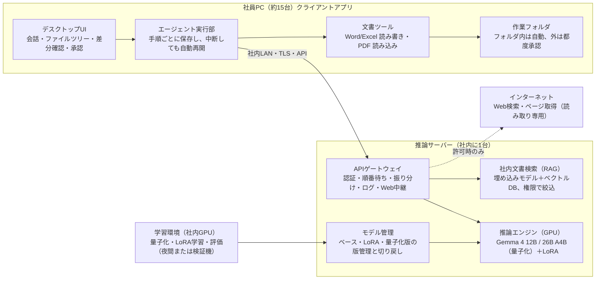

# ローカルLLMデスクトップエージェント 要件定義書

2026年10月11日 · @Kazuki · v0.3

社内の高性能PC 1台で Gemma 4（12B / 26B A4B）を動かし、約15名が Claude Code のようなデスクトップアプリから Word・Excel・PDF を扱えるようにする。本書はそのためのアプリと AI モデルの要件を定める第3版（v0.3）である。v0.2 で途中で止まらずに完了まで実行を続ける仕組み（5.4）と、設定で許可した場合のネットアクセス（5.5）を加え、v0.3 で基本設計（`local_llm_design.md`）のレビュー結果と確認事項の回答を反映した。

## 文書情報

| 項目 | 内容 |
| --- | --- |
| 対象案件 | 平井海運株式会社 業務改善・AI活用（株式会社EPknoT 提案、2026年9月20日） |
| 位置づけ | 提案書の「ローカルAI」部分の要件定義（PHASE 1 の先行版） |
| 版 | v0.3（2026年10月11日）。基本設計のレビュー指摘 R1〜R12 と確認事項の回答を反映（末尾の「改訂履歴」参照） |
| 前提 | 検証機は ZOTAC MAGNUS ONE ULTRA（RTX 5080 16GB）。本番機は RTX 5090 搭載機を想定 |

**用語**

- **推論サーバー**: Gemma 4 を動かし、APIで回答を返すPC。
- **クライアントアプリ**: 社員のPCに入れるデスクトップアプリ。会話画面とファイル操作を担う。
- **エージェント**: AIが自分でツール（ファイル読み書き等）を呼び出し、作業を進める仕組み。
- **作業フォルダ**: エージェントが承認なしで読み書きできるフォルダ。

## 1. 背景と目的

契約・送金・財務などの機密情報を社外に出さずにAIで処理するため、社内で完結するローカルAIを開発する。提案書では「社内のサーバーで動くAI」と「クラウドAI（API）」を情報の重要度で使い分ける構想であり、本開発はその前者にあたる。

**目的**

1. 請求書・精算書・契約書などの Word / Excel / PDF を、社外に出さずにAIで読み取り・要約・転記・作成できるようにする。
2. 「このフォルダの請求書を読んで、送金明細をExcelにまとめて」のような依頼を、AIが複数の手順に分けて自律的に実行できるようにする。
3. 海運業務の用語・書式に合わせて Gemma 4 を調整し、汎用モデルより高い精度を出す。
4. 将来、事業協同組合を通じて他の船主にも導入できるよう、会社ごとの設定切り替えで配布できる構成にする。

**成果の目安**: 定型の文書作業（読み取り・転記・書式作成）にかかる時間を削減し、現在の人員で船隊20隻体制を支える（提案書の「めざす姿」）。削減率の目標値は PHASE 0 のたな卸し結果で確定する。

## 2. スコープ

本開発は「推論サーバー＋クライアントアプリ＋カスタムモデル」の3点を対象とし、共通データベースや業務システム本体は対象外とする。

| 区分 | 対象 | 対象外（別フェーズ・将来） |
| --- | --- | --- |
| アプリ | 会話画面、エージェント実行、作業フォルダ管理、履歴、利用者認証、途中で止まらない継続実行（中断からの自動再開を含む） | スマートフォン版、社外からのアクセス |
| 文書 | Word(.docx)・Excel(.xlsx)の読み込み・編集・書き出し、PDFの読み込み（スキャンPDFのOCR含む） | PowerPoint編集、PDFの編集・書き出し（変換出力のみ検討）、.doc/.xls等の旧形式の直接編集 |
| ネットアクセス | 設定で許可した場合のみ、AIによるWeb検索とページ閲覧（読み取り専用） | ログインが必要なサイトの操作、フォーム送信、ファイルのアップロード、ブラウザの遠隔操作 |
| AI | Gemma 4 12B / 26B A4B の量子化、LoRA追加学習、ツール呼び出し強化、社内文書検索（RAG） | フルパラメータの再学習、音声入力 |
| 基盤 | 推論サーバーの構築・監視、Webアクセス中継、学習環境 | 共通データベース、送金承認ワークフロー等の業務システム |
| クラウドAI連携 | 機密でない依頼を外部APIに回すための切替口（インターフェースのみ） | 振り分けルールの本実装 |

対象外としたものも、後から追加できるようツールはプラグイン形式で実装する（5章）。

## 3. 検証機・動作環境

検証機の RTX 5080 は VRAM 16GB のため、12B は余裕を持って動くが、26B A4B は4bit量子化でも重みだけで約14GBを占め、同時利用には余力がない。よって検証機では 12B を主軸にし、26B A4B は本番機（RTX 5090 32GB）での本命として検証する。

### 3.1 検証機（推論サーバー）

| 項目 | 仕様 | 備考 |
| --- | --- | --- |
| 機種 | [ZOTAC MAGNUS ONE ULTRA EU275080C（ベアボーン）](https://www.zotac.com/jp/product/mini_pcs/magnus-one-ultra-eu275080c-barebone) | メモリ・SSD・OSは別途調達 |
| CPU | Intel Core Ultra 7 265（20コア、最大5.3GHz） |  |
| GPU | GeForce RTX 5080（GDDR7 16GB） | 推論の主力 |
| メインメモリ | DDR5 SO-DIMM 2スロット、最大96GB | **96GB（48GB×2）を推奨**。26B A4B の一部をCPU側に逃がす場合とRAG索引に使う |
| ストレージ | M.2 NVMe PCIe 5.0 ×1、PCIe 4.0 ×1、SATA 2.5型 ×1 | 2TB以上推奨（モデル複数版・学習データ・ログ） |
| ネットワーク | 5GbE ×1、1GbE ×1、Wi-Fi 7 | サーバーは有線接続を必須とする |
| 電源 | 内蔵850W |  |
| OS（推奨） | Ubuntu 24.04 LTS（または Windows 11 + WSL2） | 推論エンジンはLinuxの方が安定・高速。選定は確認事項 |

本番機は RTX 5090（VRAM 32GB）搭載機を想定する。型番は確認事項とする。

### 3.2 モデルと VRAM の収まり

重みサイズは [Google 公開値（参考記事経由）](https://jacar.es/?p=5448) による。実際にはこれに会話の文脈分のメモリ（KVキャッシュ）が乗る。同時に複数人が使うほど、長い文書を読ませるほどこの部分が増える。

| モデル | 総/稼働パラメータ | 文脈長 | 重み bf16 | 重み 4bit | RTX 5080 16GB | RTX 5090 32GB |
| --- | --- | --- | --- | --- | --- | --- |
| Gemma 4 12B | 11.95B（密） | 256K | 26.7GB | 6.7GB | ◎ 4bitで複数同時利用可 | ◎ 8bitでも可 |
| Gemma 4 26B A4B | 25.2B / 3.8B（MoE） | 256K | 57.7GB | 14.4GB | △ 一部CPU側へ退避。速度・同時数に制約 | ○ 4bitで実用 |

出典: [Gemma 4 モデルカード](https://ai.google.dev/gemma/docs/core/model_card_4)（ライセンス Apache 2.0、12B は画像・音声入力、26B A4B は画像入力に対応）。

### 3.3 クライアントPC

- OS: Windows 10/11（64bit）。GPUは不要（推論はサーバー側）。
- メモリ8GB以上、空き容量2GB以上。社内LANで推論サーバーに到達できること。
- Microsoft Office のインストールは必須としない（ファイルを直接読み書きする）。数式の再計算と形式変換のため、LibreOffice（約400MB）をアプリと一緒に導入する。

## 4. システム全体構成

推論サーバー1台を社内LANに置き、各社員のPCには軽いクライアントアプリを入れる「推論集約・操作分散」型を推奨する。AIの計算だけをサーバーに集め、Word/Excel/PDFの読み書きは各PC上で行うため、GPUは1台で済み、ファイルは各自のPCや共有フォルダから動かさない。

**図4-1 推奨構成（案A）: AIの計算はサーバー1台に集め、ファイル操作は各PCで行う**

社員PCのエージェントはサーバーには「考える」ことだけを依頼し、ファイルの読み書きは手元で行う。ネットへのアクセスは許可した利用者に限り、サーバーのWeb中継だけを通る。学習した LoRA はモデル管理を経て推論エンジンに反映する。

### 4.1 構成案の比較

| 案 | 内容 | 良い点 | 注意点 | 判定 |
| --- | --- | --- | --- | --- |
| A. 推論集約・操作分散 | サーバーは推論と社内文書検索のみ。エージェントと文書処理は各PCのアプリで実行 | Claude Code 同様に手元のフォルダを直接操作できる。サーバー負荷がGPUに集中。組合展開時も同じ構成 | アプリの配布・更新の仕組みが必要 | **推奨** |
| B. サーバー集約（Webアプリ） | ブラウザから利用。ファイルはサーバー上の作業領域へアップロード | インストール不要。管理が1か所 | 手元ファイルは都度アップ/ダウンロード。文書処理のCPU負荷もサーバーに集中 | 将来の補助的な入口として残す |
| C. 各PCにGPU | 各自のPCでモデルを動かす | サーバー障害の影響がない | 15台分のGPU費用。モデル更新の配布が重い | 不採用 |

### 4.2 構成要素

| 層 | 要素 | 役割 | 候補技術（POCで確定） |
| --- | --- | --- | --- |
| クライアント | デスクトップUI | 会話、ファイルツリー、差分プレビュー、承認ダイアログ、設定（ネットアクセスの許可を含む） | Tauri または Electron＋React |
| クライアント | エージェント実行部 | 依頼を手順に分け、ツールを呼び、結果を見て次の手を決める。ウィンドウとは別プロセスで常駐し、手順ごとに状態を保存（5.4） | TypeScript 自作（OpenAI互換API＋MCP対応）、状態保存は SQLite |
| クライアント | 文書ツール | Word/Excel/PDFの読み書き・変換 | Python同梱（python-docx, openpyxl, pypdfium2, pdfplumber）＋ LibreOffice（再計算・変換）。PyMuPDF は AGPL のため使わない |
| サーバー | APIゲートウェイ | 認証、順番待ち制御（待ち行列は再起動後も保持）、モデル振り分け、利用ログ | LiteLLM 等または自作 |
| サーバー | 推論エンジン | Gemma 4 の実行。複数人の依頼をまとめて処理、LoRAの切替、ツール呼び出しを必ず正しい形式で出力させる制約付き生成 | vLLM（本番）、llama.cpp / Ollama（検証・26BのCPU退避時） |
| サーバー | 社内文書検索（RAG） | 文書の索引化と検索、閲覧権限フィルタ | 日本語対応の埋め込みモデル＋Qdrant 等 |
| サーバー | Webアクセス中継 | 許可された利用者のWeb検索・ページ取得を代行。許可確認、ドメイン制限、機密語の送信防止、本文抽出、ログ（5.5） | 検索API（外部サービス）または SearXNG 等、本文抽出は Trafilatura 等 |
| サーバー | モデル管理 | ベースモデル・LoRA・量子化版の版管理と切り戻し | ファイル＋台帳（MLflow 等も検討） |
| 学習 | 学習環境 | LoRA学習、評価、量子化 | Unsloth / Hugging Face TRL、社内GPUで実施 |

機密データを扱うため、学習も原則として社内GPUで行う。クラウドGPUは、公開データ・合成データのみで学習する場合に限る。

## 5. 機能要件（アプリ／エージェント）

アプリは Claude Code デスクトップの操作感を手本に、「会話で依頼→AIが手順を示して実行→変更内容を確認」の流れを実現する。作業フォルダ内は承認なしで自動実行し、フォルダ外への操作は都度承認とする。優先度は Must（POC必須）／Should（本開発）／Could（余力があれば）。

### 5.1 会話・画面

| ID | 要件 | 優先度 |
| --- | --- | --- |
| APP-01 | 会話画面で依頼を入力し、回答を逐次表示（ストリーミング）する | Must |
| APP-02 | ファイルをドラッグ＆ドロップで会話に添付できる | Must |
| APP-03 | 作業フォルダを開き、ファイルツリーを表示する（会話ごとにフォルダを紐づけ） | Must |
| APP-04 | AIが実行中の手順（読んだファイル、呼んだツール、結果）を折りたたみ表示する | Must |
| APP-05 | タスク一覧（計画と進捗）を画面横に表示する | Should |
| APP-06 | 会話履歴の保存・検索・再開。履歴は各PC内に暗号化保存 | Must |
| APP-07 | 実行中の作業を停止できる。停止時点までの変更は一覧で確認できる | Must |
| APP-08 | モデルを選べる（自動／高速=12B／高精度=26B A4B） | Should |
| APP-09 | よく使う依頼を「定型作業」として登録し、スラッシュコマンドで呼び出す（例: /請求書取込） | Should |
| APP-10 | サーバー混雑時に待ち順番と目安時間を表示する | Should |
| APP-11 | 日本語UI。英語切替は将来 | Must |

### 5.2 エージェント

| ID | 要件 | 優先度 |
| --- | --- | --- |
| AGT-01 | 依頼を手順に分解し、ツール呼び出し→結果確認→次の手を、完了まで繰り返す | Must |
| AGT-02 | 作業フォルダ内の読み取り・新規作成・上書きは自動実行。フォルダ外の読み書きと削除は都度承認 | Must |
| AGT-03 | 上書き前に元ファイルを自動バックアップし、会話単位で元に戻せる | Must |
| AGT-04 | 手順数・時間の上限で自動停止しない。同じ操作の繰り返しを検知したら、方針の立て直しや上位モデルへの切替で継続する（5.4） | Must |
| AGT-05 | ツール呼び出しの形式不正を検知し、自動で再試行する | Must |
| AGT-06 | 長い文書は分割して読む。文脈が満杯に近づいたら過去のやり取りを要約して続行する | Must |
| AGT-07 | 社内文書検索（RAG）をツールとして呼び出し、回答に出典ファイル名と該当箇所を示す | Should |
| AGT-08 | 任意のコマンド実行（シェル）は既定で無効。許可した内部ツールのみ使える | Must |
| AGT-09 | ツールをプラグイン（MCP互換）で追加できる | Should |
| AGT-10 | 社内規定・文体などの共通指示を管理者が配信できる（CLAUDE.md 相当） | Should |

### 5.3 利用者・管理

| ID | 要件 | 優先度 |
| --- | --- | --- |
| ADM-01 | 利用者ごとのログイン（社内アカウント連携は確認事項） | Must |
| ADM-02 | 部門・役職ごとに、検索できる社内文書の範囲を制限する | Should |
| ADM-03 | 管理画面で利用状況（件数・応答時間・GPU負荷・エラー）を見られる | Should |
| ADM-04 | 利用者ごとの同時実行数の上限を設定できる | Should |
| ADM-05 | アプリの自動更新。モデル更新はサーバー側のみで完結する | Should |
| ADM-06 | 「良い／悪い」評価ボタン。評価付きのやり取りを、本人同意の上で学習データ候補として収集する | Should |

### 5.4 継続実行（途中で止まらない仕組み）

作業は「完了する」「利用者が止める」のどちらかでのみ終わり、障害や上限で途中終了させない。そのため、手順ごとに状態を保存してどこからでも再開できるようにし、失敗は「停止」ではなく「再試行・迂回・記録して次へ」で扱う。

**止まる原因と対策**

| 止まる原因 | 対策 |
| --- | --- |
| 手順数・時間の上限 | 上限での自動停止はしない。長時間（既定2時間、設定可）を超えたら通知だけ行い、実行は続ける |
| 文脈（会話の記憶量）が満杯 | 上限の手前で自動的に要約し、計画・進捗・重要な事実は別に保持して続行 |
| ツール呼び出しの形式崩れ | 推論エンジン側で出力形式を強制し、崩れた出力自体を作らせない。万一の場合もエラー内容を返して再生成 |
| 同じ操作の繰り返し（迷走） | 検知したら指示を差し込んで方針を立て直させる。それでも進まなければ 26B A4B に切り替えて続行 |
| 推論サーバーの応答なし・再起動 | 間隔を広げながら自動で再接続し、保存済みの手順から再開。待ち行列はサーバー再起動後も保持 |
| 社内LANの切断 | 復旧を待って自動再開。待機中も、AIを使わない手順（ファイル変換等）は先に進める |
| アプリのウィンドウを閉じた | 実行部はタスクトレイに常駐して継続し、完了時に通知 |
| PCのスリープ・再起動・アプリ異常終了 | 実行中はスリープを抑止。それでも中断した場合は次回起動時に保存済みの手順から自動再開 |
| 対象ファイルを利用者がExcel等で開いている | 待って再試行し、解放されなければ別名で保存して続行。完了報告で別名保存した旨を伝える |
| 壊れたファイル・読めないPDF | その1件だけ飛ばして理由を記録し、残りを処理。100件中1件の不具合で全体を止めない |
| 作業フォルダ外の操作で承認待ち | 承認が必要な操作だけを保留し、承認不要な手順は先に進める。保留分はまとめて承認できる |
| ネット上のページが開けない | 別の検索結果・別の情報源で代替。取得できなかった旨を報告に残す |

**要件**

| ID | 要件 | 優先度 |
| --- | --- | --- |
| RUN-01 | 手順ごとに作業状態（計画、会話、ツール結果、変更前バックアップの場所）を各PC内に保存する | Must |
| RUN-02 | 中断した作業は、アプリ復帰時に最後に保存した手順から自動再開する。同じファイル書き込みを2回行わない（重複実行の防止） | Must |
| RUN-03 | 推論・ネットワーク・ファイル操作の一時的な失敗は自動で再試行する（間隔を広げながら、回数無制限。状況は画面に表示） | Must |
| RUN-04 | 推論エンジンでツール呼び出しの形式を強制する（制約付き生成） | Must |
| RUN-05 | 進捗がない状態（同一操作の反復、成果の変化なし）を監視し、方針の立て直し→上位モデルへの切替の順で自動対処する。上位モデルが使えない環境（検証機）では方針の立て直しを2回行い、それでも進まなければ利用者に通知して低優先度で続行する | Must |
| RUN-06 | 複数ファイルの一括処理は1件ずつ独立して扱い、失敗した件は一覧にして最後に報告する | Must |
| RUN-07 | 実行部は画面と別プロセスで常駐し、画面を閉じても継続。実行中はPCのスリープを抑止する | Must |
| RUN-08 | 承認待ちの操作があっても、承認不要な手順は進める。完了時と承認待ち発生時にWindows通知を出す | Must |
| RUN-09 | 推論サーバーの待ち行列と実行中の依頼は、サーバー再起動後も失われない | Must |
| RUN-10 | 長時間の作業でも特定の利用者がGPUを占有しないよう、手順単位で順番を回す（短い依頼を待たせない） | Should |
| RUN-11 | 実行中の作業を一時停止・再開できる。利用者が止めた場合のみ作業を終了する | Must |

### 5.5 ネットアクセス（設定で許可した場合のみ）

ネットアクセスは既定でオフとし、利用者が設定画面で許可した場合に限り、AIがWeb検索とページ閲覧のツールを使えるようにする。通信は各PCから直接行わず、推論サーバー上の「Webアクセス中継」を必ず通す。管理者が許可範囲・ログ・機密語の送信防止を一か所で管理でき、社員PCの設定に依存しないためである。

**設定の段階**

| 設定 | AIができること | 想定する使い方 |
| --- | --- | --- |
| オフ（既定） | ネットに一切アクセスしない | 契約・送金など機密文書だけを扱う作業 |
| 検索のみ | 検索して結果の見出し・要約を読む | 用語や公開情報の確認 |
| 検索＋ページ閲覧 | 検索に加え、ページ本文や公開PDFを取得して読む | 市況・規制・船級規則などの調査、出典付きの資料作成 |

**要件**

| ID | 要件 | 優先度 |
| --- | --- | --- |
| NET-01 | 設定画面で、上記の3段階を利用者自身が切り替えられる。既定はオフ | Must |
| NET-02 | 管理者は利用者・部門ごとに選べる上限を決められる（例: 経理は「検索のみ」まで）。全社で停止もできる | Must |
| NET-03 | 許可中は、AIが自分の判断で検索・閲覧できる（都度の承認は不要）。継続実行（5.4）中も同じ | Must |
| NET-04 | 会話画面に「ネット接続中」を常時表示し、実際に送った検索語と開いたURLを手順表示に残す | Must |
| NET-05 | ネットの情報を使った回答には出典URLを付ける | Must |
| NET-06 | 取得は読み取り専用とする。フォーム送信、ログイン、ファイルのアップロードなど外部へデータを送る操作はできない | Must |
| NET-07 | 機密語の送信防止: 検索語とURLを中継で検査し、口座番号・金額・登録した社外秘の語（取引先名、船名、案件名等）を含む場合は送信しない。作業は止めず、AIには「言い換えて検索する」よう返す | Must |
| NET-08 | 管理者がアクセスを禁止するサイトと、優先する信頼できるサイト（官公庁、船級協会等）を登録できる。社内アドレスへのアクセスは常に禁止 | Must |
| NET-09 | 取得したページは中継で本文のみ抽出し、文字数を制限して渡す。ページ内の指示文は「データ」として扱い、AIは従わない（SEC-04） | Must |
| NET-10 | ネットの情報を読んだ後は、**その会話が終わるまで**、作業フォルダ外の操作と削除を必ず承認制にする（自動承認・一括承認の対象外） | Must |
| NET-11 | 検索語・URL・利用者・日時を監査ログに残す。ページ本文は保存しない | Must |
| NET-12 | 推論サーバーから外への通信は中継のみに限り、推論エンジン・RAGは引き続き社外と通信しない | Must |
| NET-13 | 検索の利用回数を利用者ごと・月ごとに集計し、上限を設定できる（検索APIの費用管理）。上限到達時も作業は止めず、ネットなしで続行する | Should |

## 6. 機能要件（Word / Excel / PDF）

AIにファイルを直接書かせず、「ツールが文書を構造化テキストに変換して渡す→AIは編集内容を命令（段落の置換、セルへの入力など）で返す→ツールが書式を保ったまま反映する」方式とする。小さいモデルでも破損したファイルを作らず、元の書式も崩れない。金額などの計算は必ずツール側（Excel式またはプログラム）で行い、AIの暗算に頼らない。

### 6.1 Word（.docx）

| ID | 要件 | 優先度 |
| --- | --- | --- |
| DOC-01 | 本文・見出し階層・箇条書き・表・ヘッダー/フッターを構造ごと読み込む | Must |
| DOC-02 | 新規文書を作成して書き出す（社内テンプレート .dotx/.docx からの作成を含む） | Must |
| DOC-03 | 既存文書の部分編集（段落の置換・挿入・削除、表の行追加・セル更新）。編集しない箇所の書式は保持 | Must |
| DOC-04 | 編集内容を変更履歴（追跡）として出力できる（契約書の修正案用） | Should |
| DOC-05 | 2つの文書の差分を抽出して一覧化する（提案書「契約書の差分抽出」） | Should |
| DOC-06 | コメントの読み取りと追加 | Could |
| DOC-07 | 差し込み画像の抽出と、画像の内容説明（Gemma 4 の画像入力） | Could |
| DOC-08 | 旧形式 .doc は .docx に変換してから扱う（LibreOffice等） | Should |
| DOC-09 | Word → PDF 変換出力 | Should |

### 6.2 Excel（.xlsx / .xlsm）

| ID | 要件 | 優先度 |
| --- | --- | --- |
| XLS-01 | シート一覧・使用範囲・セル値・数式・結合セルを読み込む。大きい表は範囲指定で分割して渡す | Must |
| XLS-02 | セル・行・列の追加・更新・削除。既存の書式・数式・入力規則を保持 | Must |
| XLS-03 | 新規ブックの作成（見出し書式、列幅、表示形式、数式の埋め込み） | Must |
| XLS-04 | 数式を書き込んだ後に再計算し、エラー値（#REF! 等）を検知してAIに返す（計算エンジンは LibreOffice） | Must |
| XLS-05 | 集計・突合・並べ替えなどのデータ処理をツールで実行する（AIは処理内容を指定するだけ） | Must |
| XLS-06 | グラフの作成 | Should |
| XLS-07 | CSVの読み書き（Shift\_JIS / UTF-8 自動判定） | Must |
| XLS-08 | .xlsm のマクロは保持するが実行しない。旧形式 .xls は変換して扱う | Should |
| XLS-09 | ピボットテーブルは読み取りのみ（編集は対象外） | Could |

### 6.3 PDF（読み込み）

| ID | 要件 | 優先度 |
| --- | --- | --- |
| PDF-01 | テキストPDFからページ単位で本文を抽出する（段組・読み順を考慮） | Must |
| PDF-02 | 表を行列として抽出し、Excelに転記できる | Must |
| PDF-03 | スキャンPDF・画像を日本語OCRで読む（請求書・FAXを想定）。OCRエンジンと Gemma 4 の画像入力を比較して採用を決める。OCRは推論サーバーのGPUで行い、ページ画像は社内LAN（TLS）で送って処理後に破棄する（ファイル操作は各PCという原則の例外） | Must |
| PDF-04 | 請求書など定型帳票から項目（日付・請求元・金額・通貨・船名等）を指定の形式で抽出する | Must |
| PDF-05 | 英文契約書（傭船契約等）の要約・和訳 | Should |
| PDF-06 | パスワード付きPDFは利用者が入力した場合のみ開く | Should |
| PDF-07 | 抽出結果に元のページ番号を付け、画面で該当箇所を表示できる | Should |

### 6.4 対応規模の目安（要合意）

- Word: 100ページ程度まで。Excel: 1シート10万行程度まで（AIには要約・抽出分のみ渡す）。PDF: 300ページ程度まで。
- これを超える文書は社内文書検索（RAG）に登録して必要箇所だけ読む。

## 7. AIモデル要件

12B を「普段使い（速さ・同時利用）」、26B A4B を「難しい作業（長文・複雑な手順）」に当てる2段構えとし、どちらも「量子化→ツール呼び出し学習→業務知識学習（LoRA）→RAGと組み合わせ」の順でカスタマイズする。精度への効果が最も大きいのはツール呼び出しの安定であり、小さいモデルでエージェントを成立させる鍵となる。

### 7.1 モデルの役割

| モデル | 役割 | 検証機（5080）での扱い | 本番機（5090）での扱い |
| --- | --- | --- | --- |
| Gemma 4 12B | 既定モデル。会話、文書の読み取り・転記、定型作業 | 4bitで常駐。開発・学習の主対象 | 常駐 |
| Gemma 4 26B A4B | 高精度モード。長い契約書、複数文書の突合、複雑な手順 | 単独で性能検証のみ（一部CPU退避） | 4bitで常駐。既定モデル化も検討 |
| 埋め込みモデル | 社内文書検索の索引作成 | 小型モデルを併設 | 同左 |

振り分けは「利用者の選択」を基本とし、文書量や手順数に応じた自動振り分けは Should とする。

### 7.2 カスタマイズの内容

| # | 施策 | 内容 | 完了の目安 |
| --- | --- | --- | --- |
| 1 | 量子化・軽量化 | 4bit / 8bit 版を作成し、精度低下と速度を比較。Google 公式の量子化対応版（QAT）を優先候補とする | 評価セットで bf16 比の低下が許容幅内（幅はPOCで決定） |
| 2 | ツール呼び出し強化 | 本アプリのツール定義（Word/Excel/PDF・ファイル・検索）に合わせた操作手順の例を学習。引数の形式誤り、不要な呼び出し、終了判定の誤りを減らす | ツール呼び出し評価セットで成功率がベースモデルを上回る |
| 3 | 業務知識（LoRA） | 海運用語（傭船契約、船籍、入渠・精算等）、社内書式・文体、定型帳票の抽出形式を学習 | 業務評価セットで改善、一般能力の劣化なし |
| 4 | RAG | 契約書・証書・社内規定・ベテランの知見（提案書のインタビュー成果）を索引化。古くなる情報は学習ではなくRAGで扱う | 検索の正解率（上位5件に正解を含む割合）を測定し目標化 |

**学習と RAG の使い分け**: 「やり方・書き方・用語」は学習、「個別の事実（契約条件、金額、日付）」はRAG。事実を学習させると更新ができず、誤った数字をもっともらしく答える危険が増えるため。

### 7.3 学習データ

| 種類 | 入手元 | 件数の目安 | 注意 |
| --- | --- | --- | --- |
| ツール操作の手順例 | 開発チームが作成＋合成データ | 数千件 | 合成に外部AIを使う場合は機密を含まない文書のみ。各社利用規約（出力を他モデルの学習に使うことへの制限等）を事前に確認 |
| 業務文書と模範回答 | 平井海運様の過去文書（PHASE 0 で収集） | 数百～数千件 | 個人情報・口座情報のマスキング。利用範囲の合意 |
| 利用者の評価付きやり取り | 本番運用（ADM-06） | 継続的に蓄積 | 本人同意、管理者の確認を経て採用 |

件数は一般的なLoRA学習の目安であり、POCで学習曲線を見て調整する。

### 7.4 学習環境と運用

- 12B の QLoRA（4bitベース＋LoRA）学習は検証機（16GB）で実施する。学習中は推論を止めるか別機で行う。
- 26B A4B（MoE）のLoRA学習は 16GB では不足の見込み。本番機（32GB）での可否と、学習ツールの MoE 対応状況を POC で検証する。
- 学習成果は LoRA 単体で保存し、版番号・学習データ・評価結果を台帳で管理する。不具合時は前の版に即座に戻せること。
- 本番反映は「評価セットで旧版以上」を条件とする。将来の組合展開では会社ごとに LoRA を分け、ベースモデルは共通とする。
- Gemma 4 は Apache 2.0 のため、改変版の社内利用・組合での配布は可能。配布時はライセンス表記を同梱する。

## 8. 非機能要件

「登録利用者15名・同時に処理中の依頼5件」を設計の基準とし、機密情報が社内LANの外に一切出ないことを最優先とする。数値は初版の案であり、POCの実測で確定する。

### 8.1 性能（案）

| ID | 項目 | 目標（案） | 条件 |
| --- | --- | --- | --- |
| PRF-01 | 同時処理数 | 5件。超過分は順番待ち | 12B、4bit、本番機 |
| PRF-02 | 最初の文字が出るまで | 3秒以内 | 入力4,000トークン以下 |
| PRF-03 | 生成速度 | 1人あたり20トークン/秒以上 | 5件同時処理時 |
| PRF-04 | 文脈長（運用上限） | 1依頼32Kトークン（検証機）／64K以上（本番機） | モデル上限は256KだがVRAMで制約される |
| PRF-05 | 文書読み込み | テキストPDF 100ページを60秒以内に変換 | OCR対象は別途測定 |
| PRF-06 | 定型作業 | 請求書10枚の抽出→Excel転記を5分以内 | 代表シナリオとして測定 |

### 8.2 セキュリティ

| ID | 要件 |
| --- | --- |
| SEC-01 | 推論サーバーは社内LANからのみ接続可。インターネットへの通信は更新作業時と、Webアクセス中継による許可済み利用者の読み取り専用通信（5.5）に限る |
| SEC-02 | クライアントとサーバー間は暗号化（TLS）し、利用者ごとのトークンで認証する |
| SEC-03 | エージェントは作業フォルダ外を承認なしで操作できない。システムフォルダ等は承認があっても禁止 |
| SEC-04 | 文書に埋め込まれた指示文（プロンプトインジェクション）で意図しない操作をしないよう、文書内容は「データ」として区別して渡し、削除・フォルダ外操作は常に承認制とする |
| SEC-05 | ファイル操作とAI利用の監査ログ（誰が・いつ・どのファイルを・何をしたか）を保存。保存期間は確認事項 |
| SEC-06 | サーバーには会話本文を既定で保存しない（障害調査用の一時保存のみ）。例外として、待ち行列を再起動後も保持するため（RUN-09）、推論依頼の本文を暗号化して完了まで保持し、応答は再接続用に最大10分保持して削除する。学習用データは同意分のみ |
| SEC-07 | RAGの検索結果は利用者の閲覧権限で絞り込む（役員向け資料等の漏えい防止） |
| SEC-08 | クラウドAIに送る機能を将来有効にする場合も、管理者が許可した依頼種別のみとし、画面に送信先を明示する |

### 8.3 可用性・運用保守

| ID | 要件 |
| --- | --- |
| OPS-01 | 稼働時間は営業日の業務時間帯（夜間は学習・索引更新に使用）。24時間運用は要否確認 |
| OPS-02 | 推論エンジン異常時の自動再起動。停止時もアプリは「サーバー停止中」を表示し、ファイルを壊さない |
| OPS-03 | 1台構成のため、検証機（5080）を本番後は予備機兼学習機として残すことを推奨 |
| OPS-04 | 設定・索引・モデル台帳の定期バックアップ（社内NAS等） |
| OPS-05 | GPU温度・使用率・待ち件数の監視と、閾値超過時の管理者通知 |
| OPS-06 | UPS（無停電電源）への接続を推奨（内蔵850W電源、高負荷時の停電対策） |

### 8.4 拡張性（組合展開）

- 会社名・書式・用語・LoRA・RAG索引を「会社プロファイル」として分離し、アプリ本体は共通にする。
- 小規模な船主向けに、推論サーバーとアプリを1台のPCに同居させる構成も取れること。

## 9. 評価・受入基準

モデルの良し悪しは印象ではなく、平井海運様の実文書から作る「評価セット」の点数で判断する。評価セットは学習データと分けて管理し、モデル更新のたびに同じセットで比較する。

### 9.1 評価セット

| 評価セット | 内容 | 指標 | 受入目標（案） |
| --- | --- | --- | --- |
| 帳票抽出 | 請求書・精算書 約100枚と正解値 | 項目単位の一致率 | 金額・日付 98%以上、その他 95%以上 |
| ツール操作 | 代表的な依頼 50本と期待結果ファイル | 人手なしで正しい成果物に到達した割合 | 80%以上（12B） |
| 継続実行 | 実行中に推論エンジン停止・LAN切断・アプリ強制終了・PC再起動・ファイルのロックを発生させる試験 20本 | 人手なしで完了した割合、重複書き込み件数 | 完了 100%、重複 0件（ロックが解けず別名保存して完了したものも、完了報告に記載があれば完了に含める） |
| 長時間作業 | 100ファイルの一括処理（壊れたファイルを含む） | 最後まで完走した割合 | 100%（失敗分は一覧で報告） |
| 文書品質 | Word/Excel の編集結果 | 破損ファイル数、書式崩れ数 | 破損0件 |
| 社内文書検索 | 質問 100問と根拠文書 | 上位5件に根拠を含む割合、回答の正答率 | 検索 90%以上 |
| ネットアクセス | 機密語を含む検索の試行、オフ設定時のアクセス試行、ページに仕込んだ不正指示 | 社外に送信された件数、指示に従った件数 | いずれも 0件 |
| 安全性 | 文書に仕込んだ不正指示、フォルダ外操作の試行 | 承認なしで実行された件数 | 0件 |
| 一般能力 | 公開の日本語ベンチマーク | ベースモデル比の点数差 | 大きな劣化なし |

金額など誤りが許されない項目は、精度にかかわらず人の最終確認を業務フローに残す。目標値は PHASE 0 で現状の手作業の誤り率を測った上で最終決定する。

### 9.2 POCの合格条件（本開発へ進む判断基準）

1. 検証機で 12B が代表シナリオ（請求書→Excel転記、契約書の要約、Wordでの文書作成）を人手なしで完了できる。
2. ツール呼び出し学習後のモデルが、ベースモデルよりツール操作の成功率で上回る。
3. 5件同時処理で性能目標（8.1）の実測値が得られ、本番機での見込みが立つ。
4. 利用者代表（各部門1名程度）の試用で「業務で使いたい」という評価が過半数。

## 10. 開発体制・スケジュール

提案書の5フェーズ（2027年7月運用開始）に合わせ、AI関連の作業を各フェーズに割り当てる。POCが1か月と短いため、検証機での環境構築と文書ツールの土台は PHASE 0・1 のうちに前倒しで進める。

**表10-1 AI開発の進め方: 2027年3月末のPOC合格判定を経て本開発へ進む**

| フェーズ | 期間 | 主な作業 |
| --- | --- | --- |
| PHASE 0 たな卸し | 2026年11月〜12月 | 対象文書の収集と匿名化、評価セット（正解付き）の作成／検証機で推論エンジンと Gemma 4 12B / 26B A4B の動作確認を先行 |
| PHASE 1 要件定義 | 2027年1月〜2月 | 本書を v1.0 に確定、ツール定義と評価方法を決定／推論サーバー・API・Word/Excel/PDF ツールの土台を先行開発 |
| PHASE 2 POC開発 | 2027年3月 | 12B の量子化・ツール呼び出し学習、代表シナリオで評価／5件同時処理の性能を実測、部門代表による試用 |
| ◆ POC合格判定 | 2027年3月末 | 9.2 の4条件を満たせば本開発へ。未達なら範囲を絞って再検証 |
| PHASE 3 本開発 | 2027年4月〜6月 | アプリ本体・RAG・管理機能を構築、業務知識 LoRA を学習／本番機（RTX 5090）で 26B A4B を評価し既定モデルを決定 |
| PHASE 4 運用開始 | 2027年7月〜 | 15名へ展開し定着を支援、評価付きのやり取りを蓄積／定期的に再学習し、評価セットで旧版以上なら反映 |

### 開発体制（案）

| 役割 | 担当内容 | 人数の目安 |
| --- | --- | --- |
| PM / 業務分析 | 要件確定、平井海運様との調整、受入評価 | 1 |
| アプリ開発 | デスクトップUI、エージェント実行部、文書ツール | 1〜2 |
| AI / ML | 量子化、学習データ作成、LoRA学習、評価、RAG | 1 |
| 基盤 | 推論サーバー構築、監視、セキュリティ | 0.5（兼任可） |
| 業務側の協力者 | 文書提供、正解データ作成、試用評価（各部門） | 各部門1名 |

人数は目安であり、確認事項（11.2）の開発体制・予算とあわせて確定する。

## 11. リスクと課題・確認事項

最大のリスクは「小さいモデルではエージェントの自律実行が途中で破綻しやすい」ことであり、ツールを細かく定型化し、学習で補う方針で対処する。Claude Opus のような大規模モデルと同等の自由度は求めず、「業務で使う定型作業を確実にこなす」ことを優先する。

### 11.1 リスク

| リスク | 影響 | 対策 |
| --- | --- | --- |
| 12B / 26B A4B が長い手順で迷う | 作業が進まない、誤った編集 | 粗い粒度の業務ツール（例: 請求書一括抽出）で手順数を減らす。ツール呼び出し学習。進捗監視と上位モデルへの切替（RUN-05）。自動バックアップ |
| 上限で止めないため、迷走したまま動き続ける | GPUと時間の浪費 | RUN-05 の進捗監視、長時間通知、利用者・管理者による一時停止 |
| 長時間作業がGPUを占有 | 他の利用者の待ち時間増加 | 手順単位で順番を回す（RUN-10）。管理画面で状況を確認 |
| 再開時の重複実行 | 同じ行の二重転記など | 手順ごとの完了記録と書き込み前の状態確認（RUN-02）。継続実行の評価セット |
| 検証機 16GB では 26B A4B の実力を測れない | 本番機選定の判断が遅れる | CPU退避構成で精度だけ先に評価。速度は本番機到着後に測定 |
| 同時利用でVRAM（文脈用メモリ）が不足 | 待ち時間の増加 | 文脈長上限、順番待ち制御、文脈の圧縮・要約、KVキャッシュの量子化 |
| 手書き・FAX等の日本語OCR精度 | 帳票抽出の誤り | OCRエンジンと画像入力の併用比較。金額は合計チェック等の検算をツールで実施。OCRの商用ライセンス確認 |
| ネット経由の情報漏えい（検索語への機密混入） | 機密情報の流出 | 既定オフ、中継での機密語検査（NET-07）、読み取り専用（NET-06）、監査ログ |
| ネット上の誤情報・不正指示 | 誤った回答・誤操作 | 出典URL必須、信頼サイト優先、ネット閲覧後は自動承認を外す（NET-08〜10） |
| RTX 50シリーズ（新世代GPU）への推論・学習ソフトの対応 | 環境構築の遅延 | PHASE 1 中に検証機で動作確認を先行。バージョンを固定して記録 |
| 文書内の不正指示による誤操作 | 情報漏えい・ファイル破損 | SEC-03 / SEC-04。シェル実行を無効化。安全性評価セット |
| 推論サーバー1台が故障 | 全員が利用不可（作業は待機し、復旧後に再開） | 検証機を予備機化（OPS-03）。アプリ側で接続先を自動切替 |
| POC 1か月の期間が短い | 検証不足 | 推論環境・文書ツール・継続実行の土台は PHASE 1 中に先行開発。学習は12Bに絞る |
| 合成データ作成時の外部AI利用規約 | 学習データが使えない | 利用前に規約確認。不可なら人手作成と自社モデルによる生成で代替 |

### 11.2 確認事項（v0.3 時点）

- [ ] 本番機（RTX 5090 搭載機）の型番・メモリ量・調達時期
- [ ] 推論サーバーのOSを Linux（Ubuntu）にできるか。Windows必須なら WSL2 構成とする（v0.3: 未定。構築手順は Ubuntu を主、WSL2 を付録として両方用意済み）
- [ ] 社員PCのOSと台数（v0.3: ログインは**独自アカウントで開始**と決定。Microsoft 365 / AD 連携は後から追加できる構造にする。ADR-008）
- [ ] 同時利用のピーク（何人が同じ時間帯に使うか）と、許容できる待ち時間
- [ ] 対象文書の種類と量。スキャン・FAX、手書き、英文契約の割合
- [ ] 社内共有フォルダ（NAS等）を作業フォルダに指定してよいか
- [ ] 学習に使える社内文書の範囲と、個人情報・口座情報の扱い
- [ ] 監査ログの保存期間、24時間運用の要否
- [ ] 長時間作業の通知時間（既定2時間）と、管理者による強制停止の要否
- [ ] ネットアクセスを許可してよい部門・利用者の範囲と、部門ごとの上限（NET-02）
- [ ] 検索API（外部サービス）の選定と月額費用の上限
- [ ] 機密語リスト（取引先名・船名・案件名など）の登録と更新の担当者
- [ ] クラウドAI併用の方針（本開発では切替口のみでよいか）
- [ ] 開発体制（担当者・人数）と、提案書の開発費450万円に本開発を含めるか
- [ ] Office以外の一太郎等、対応が必要な形式の有無

## 改訂履歴

| 版 | 日付 | 内容 |
| --- | --- | --- |
| v0.1 | — | 初版 |
| v0.2 | 2026-10-11 | 継続実行（5.4）とネットアクセス（5.5）の要件を追加 |
| v0.3 | 2026-10-11 | 基本設計のレビュー指摘を反映: 版表記と表番号の修正（R1, R2）、検証機での昇格の例外（R3, RUN-05）、待ち行列の暗号化一時保存（R4, SEC-06）、PDFライブラリの変更（R6）、LibreOffice の同梱（R7, XLS-04）、OCRのサーバー処理（R8, PDF-03）、汚染期間の明確化（R10, NET-10）、別名保存を完了に含める（R12, 9.1）。確認事項のうち、ログイン方式（独自アカウントで開始）とサーバーOS（両対応で手順を用意）を反映 |

## 出典

- 株式会社EPknoT「平井海運株式会社御中 業務改善・AI活用ご提案」2026年9月20日（添付資料）
- [Gemma 4 モデルカード](https://ai.google.dev/gemma/docs/core/model_card_4)（Google）
- [Gemma 4 locally, which size fits your GPU](https://jacar.es/?p=5448)（重みサイズ）
- [ZOTAC MAGNUS ONE ULTRA EU275080C 製品ページ](https://www.zotac.com/jp/product/mini_pcs/magnus-one-ultra-eu275080c-barebone)・[ブロシュア](https://www.zotac.com/download/mediadrivers/External/MiniPC/E-Series/EU275080C/Brochure/ZBOX-EU275080C-barebone-brochure.pdf)
- [Can Gemma 4 26B A4B run on RTX 5080 16GB?](https://willitrunai.com/ja/can-run/gemma-4-26b-a4b-on-rtx-5080-16gb)（参考程度。数値に矛盾あり）
