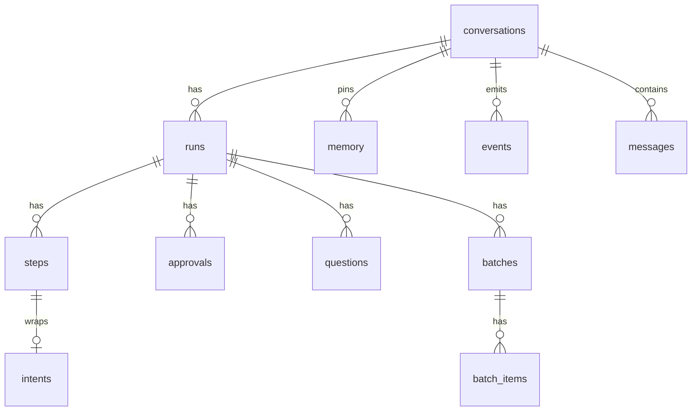
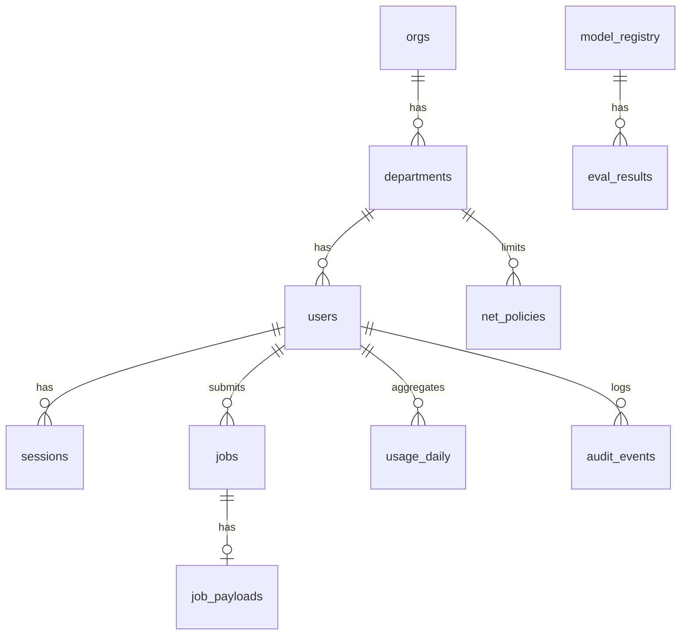

# ローカルLLMデスクトップエージェント データモデル仕様

2026年10月11日 · v1.0-draft（基本設計書 §4.4・§5.4・§6.3・§8.4 の詳細化）

クライアントの **Run Store（SQLite / SQLCipher）** と、サーバーの **PostgreSQL 16** のテーブル定義を定める。DDL の正本はマイグレーションファイル（クライアント: `packages/agent-runtime/migrations/`、サーバー: `server/gateway/migrations/`。Alembic）で、本書はその設計仕様にあたる。

---

## 1. 共通の約束

- ID は ULID（文字列26桁。時刻順に並ぶ）。表示用の短い ID（`ap-12` など）は会話内の連番から作る。
- 日時は UTC の ISO 8601 文字列（SQLite）または `timestamptz`（PostgreSQL）。
- JSON 列は SQLite では `TEXT`（`json_valid` の CHECK 制約付き）、PostgreSQL では `jsonb`。
- 本文（依頼・会話・ツール結果）を保存するのは**クライアントだけ**。サーバーには、暗号化した一時ペイロード（`job_payloads`）と監査用のメタデータしか置かない（SEC-06, R4）。

---

## 2. クライアント: Run Store（`%LOCALAPPDATA%\LocalLLMAgent\runs.db`）

- SQLCipher 4（AES-256）。鍵は初回起動時に乱数で作り、Electron の `safeStorage`（DPAPI）で暗号化して `key.bin` に保存する。
- `PRAGMA journal_mode=WAL; synchronous=FULL; foreign_keys=ON;`（遷移の確定を電源断でも失わないため `FULL` にする）。
- 書き込みは Runtime プロセスだけが行う。Main と Renderer はイベント経由で読む。

### 2.1 ER 図



### 2.2 テーブル定義

```sql
-- 会話（APP-06）。1会話 = 1作業フォルダ
CREATE TABLE conversations (
  id            TEXT PRIMARY KEY,
  title         TEXT NOT NULL,
  workspace     TEXT NOT NULL,            -- 正規化した実体パス
  model_pref    TEXT NOT NULL DEFAULT 'auto' CHECK (model_pref IN ('auto','fast','accurate')),
  tainted       INTEGER NOT NULL DEFAULT 0,   -- 汚染フラグ（会話が終わるまで保持。R10）
  tainted_at    TEXT,
  created_at    TEXT NOT NULL,
  updated_at    TEXT NOT NULL,
  deleted_at    TEXT                          -- 論理削除。backups の掃除と連動させる
);

-- 依頼1件分の実行（run.start ごとに作る）
CREATE TABLE runs (
  id              TEXT PRIMARY KEY,
  conversation_id TEXT NOT NULL REFERENCES conversations(id),
  state           TEXT NOT NULL,            -- protocol §5.2 run.state の値
  model_current   TEXT NOT NULL,            -- 'local-12b' | 'local-26b'
  escalated_at    TEXT,                     -- 昇格した時刻（RUN-05）
  stall_level     INTEGER NOT NULL DEFAULT 0, -- 0:正常 1:立て直し済み 2:昇格済み 3:停滞
  low_priority    INTEGER NOT NULL DEFAULT 0,
  started_at      TEXT NOT NULL,
  ended_at        TEXT,
  end_reason      TEXT CHECK (end_reason IN ('final','user_stop')),  -- 終わり方は2種類だけ（5.4）
  long_run_notified_at TEXT,
  context_tokens  INTEGER NOT NULL DEFAULT 0,
  next_step_seq   INTEGER NOT NULL DEFAULT 1
);
CREATE INDEX runs_active ON runs(state) WHERE ended_at IS NULL;

-- 会話のメッセージ（モデルに渡す履歴の素材）
CREATE TABLE messages (
  id              TEXT PRIMARY KEY,
  conversation_id TEXT NOT NULL REFERENCES conversations(id),
  run_id          TEXT REFERENCES runs(id),
  step_id         TEXT,
  role            TEXT NOT NULL CHECK (role IN ('user','assistant','tool','system_note')),
  content         TEXT NOT NULL,            -- JSON（Action / ToolResult / 依頼文）
  tokens          INTEGER NOT NULL,
  compacted_into  TEXT,                     -- 要約に置き換えた場合、その要約メッセージの id
  created_at      TEXT NOT NULL
);
CREATE INDEX messages_conv ON messages(conversation_id, created_at);

-- 手順（推論1手＋ツール実行1回）。遷移ごとに UPDATE をトランザクションで確定させる
CREATE TABLE steps (
  id             TEXT PRIMARY KEY,          -- run_id + ':' + seq
  run_id         TEXT NOT NULL REFERENCES runs(id),
  seq            INTEGER NOT NULL,
  phase          TEXT NOT NULL CHECK (phase IN
                   ('inferring','dispatched','policy_checked','deferred','tool_running','committed','failed_permanent')),
  attempt        INTEGER NOT NULL DEFAULT 0,  -- 推論の再投入回数（Idempotency-Key に使う）
  gateway_job_id TEXT,
  action         TEXT,                      -- モデルが返した Action（JSON）
  tool           TEXT,
  args_digest    TEXT,                      -- 正規化した args の sha256（停滞検知に使う）
  result         TEXT,                      -- ToolResult（JSON）
  result_digest  TEXT,
  error_code     TEXT,
  started_at     TEXT NOT NULL,
  ended_at       TEXT,
  UNIQUE (run_id, seq)
);

-- 書き込みの意図記録（設計書 §5.4）。重複実行を防ぐ要
CREATE TABLE intents (
  id            TEXT PRIMARY KEY,
  step_id       TEXT NOT NULL REFERENCES steps(id),
  batch_item_id TEXT,                       -- batch の出力の場合
  path          TEXT NOT NULL,              -- 実体パス
  op            TEXT NOT NULL CHECK (op IN ('create','overwrite','delete','move','copy')),
  op_digest     TEXT NOT NULL,              -- tool + args の sha256
  pre_hash      TEXT,                       -- 新規作成なら NULL
  post_hash     TEXT,
  backup_path   TEXT,
  final_path    TEXT,                       -- 別名保存になった場合の実際のパス
  status        TEXT NOT NULL CHECK (status IN ('prepared','committed','conflict','undone')),
  created_at    TEXT NOT NULL,
  committed_at  TEXT
);
CREATE INDEX intents_open ON intents(status) WHERE status = 'prepared';

-- 承認（protocol §4）
CREATE TABLE approvals (
  id            TEXT PRIMARY KEY,           -- 'ap-12' 形式（会話内で一意）
  run_id        TEXT NOT NULL REFERENCES runs(id),
  step_id       TEXT NOT NULL REFERENCES steps(id),
  request       TEXT NOT NULL,              -- ApprovalRequest（JSON）
  tainted       INTEGER NOT NULL,
  decision      TEXT CHECK (decision IN ('approve','reject')),
  remember      TEXT,
  decided_at    TEXT,
  executed_step TEXT                         -- 承認後に実行した記録
);

-- ask_user（パスワードの実値は保存しない）
CREATE TABLE questions (
  id          TEXT PRIMARY KEY,
  run_id      TEXT NOT NULL REFERENCES runs(id),
  step_id     TEXT NOT NULL,
  question    TEXT NOT NULL,
  choices     TEXT,
  secret      INTEGER NOT NULL DEFAULT 0,
  answer      TEXT,                          -- secret=1 のときは '***'（実値はメモリ上だけ）
  answered_at TEXT
);

-- 一括処理（protocol §3.6）
CREATE TABLE batches (
  id          TEXT PRIMARY KEY,
  run_id      TEXT NOT NULL REFERENCES runs(id),
  step_id     TEXT NOT NULL,
  spec        TEXT NOT NULL,                 -- BatchSpec（JSON）
  total       INTEGER NOT NULL,
  status      TEXT NOT NULL CHECK (status IN ('running','writing_output','done')),
  output_intent_id TEXT REFERENCES intents(id),
  created_at  TEXT NOT NULL,
  ended_at    TEXT
);
CREATE TABLE batch_items (
  id          TEXT PRIMARY KEY,
  batch_id    TEXT NOT NULL REFERENCES batches(id),
  idx         INTEGER NOT NULL,
  item        TEXT NOT NULL,                 -- 対象パス
  item_hash   TEXT,                          -- 処理時のファイルハッシュ
  status      TEXT NOT NULL CHECK (status IN ('pending','running','ok','failed')),
  result      TEXT,                          -- パイプラインの結果（JSON）
  error_code  TEXT, error_reason TEXT,
  attempts    INTEGER NOT NULL DEFAULT 0,
  UNIQUE (batch_id, idx)
);

-- 固定メモリ（protocol §3.7、設計書 §5.7）
CREATE TABLE memory (
  conversation_id TEXT NOT NULL REFERENCES conversations(id),
  key             TEXT NOT NULL,
  value           TEXT NOT NULL,
  updated_at      TEXT NOT NULL,
  PRIMARY KEY (conversation_id, key)
);

-- 計画（最新版だけを保持し、履歴は events に残す）
CREATE TABLE plans (
  run_id     TEXT PRIMARY KEY REFERENCES runs(id),
  plan       TEXT NOT NULL,
  updated_at TEXT NOT NULL
);

-- 画面に送ったイベント（画面を開き直したときの取り直し用。protocol §5.2）
CREATE TABLE events (
  conversation_id TEXT NOT NULL,
  seq             INTEGER NOT NULL,
  type            TEXT NOT NULL,
  payload         TEXT NOT NULL,
  created_at      TEXT NOT NULL,
  PRIMARY KEY (conversation_id, seq)
);

-- 監査ログの送信待ち（SEC-05）
CREATE TABLE audit_outbox (
  id         TEXT PRIMARY KEY,
  record     TEXT NOT NULL,                  -- {user, at, action, path, tool, result}。本文は入れない
  sent_at    TEXT
);

-- 設定（利用者ごと・端末ごと）
CREATE TABLE settings (key TEXT PRIMARY KEY, value TEXT NOT NULL);
```

### 2.3 確定の単位（トランザクション）

| 遷移 | 同じトランザクションで書くもの |
| --- | --- |
| 推論の投入 | `steps`(phase=inferring, attempt, gateway_job_id) |
| 推論の完了 | `steps.action`、`messages`(assistant)、`plans`（plan_update の場合）、`events` |
| ポリシー判定 | `steps.phase`、`approvals`（承認待ちの場合）、`events` |
| 書き込みの前 | `intents`(prepared)、`steps.phase=tool_running` |
| 書き込みの後 | `intents`(committed, post_hash)、`steps.result`、`messages`(tool)、`audit_outbox`、`events` |
| 圧縮 | 要約の `messages` を追加し、元のメッセージの `compacted_into` を更新する |

### 2.4 再開の手順（起動時）
1. `intents.status='prepared'` を設計書 §5.4 の表に従って解決する。
2. `runs` のうち `ended_at IS NULL` のものを、`steps` の最後の確定済み phase から再開する。`inferring` のものは同じ `Idempotency-Key`（`run_id:step_id:attempt`）で Gateway に問い合わせ、完了していれば結果を受け取り、なければ投入し直す。
3. `batches.status='running'` のものは、`batch_items.status IN ('pending','running')` の件から続ける。

### 2.5 保持と削除
- `backups/` と `intents` は会話を削除するときに一緒に消す。会話を残す場合でも、保持期間（既定30日）を過ぎた backups は日次で消す。消した intent の `backup_path` は NULL にする（その範囲は元に戻せなくなる）。
- `events` は会話ごとに最新5,000件を残す。

---

## 3. サーバー: PostgreSQL 16（`llmgw` データベース）

### 3.1 ER 図



### 3.2 テーブル定義

```sql
CREATE TABLE orgs (                         -- 会社プロファイル（組合展開。8.4）
  id          text PRIMARY KEY,             -- 'hirai'
  name        text NOT NULL,
  profile     jsonb NOT NULL,               -- profile.yaml を読み込んだもの
  created_at  timestamptz NOT NULL DEFAULT now()
);

CREATE TABLE departments (
  id          text PRIMARY KEY,
  org_id      text NOT NULL REFERENCES orgs(id),
  name        text NOT NULL,
  acl_groups  text[] NOT NULL DEFAULT '{}'  -- RAG の検索範囲（ADM-02, SEC-07）
);

CREATE TABLE users (
  id            text PRIMARY KEY,
  org_id        text NOT NULL REFERENCES orgs(id),
  department_id text REFERENCES departments(id),
  login         text NOT NULL UNIQUE,
  display_name  text NOT NULL,
  role          text NOT NULL CHECK (role IN ('user','admin')),
  auth_provider text NOT NULL DEFAULT 'local' CHECK (auth_provider IN ('local','oidc','ldap')),  -- ADR-008
  password_hash text,                       -- argon2id（local の場合のみ）
  external_id   text UNIQUE,              -- 外部IdP（OIDC/LDAP）の利用者ID。ADR-008
  extra_acl_groups text[] NOT NULL DEFAULT '{}',
  max_concurrent int NOT NULL DEFAULT 2,    -- ADM-04
  net_level_cap text NOT NULL DEFAULT 'off' CHECK (net_level_cap IN ('off','search','browse')), -- NET-02（部門の上限とあわせて、小さいほうを採用する）
  disabled      boolean NOT NULL DEFAULT false,
  failed_logins int NOT NULL DEFAULT 0,
  locked_until  timestamptz,
  created_at    timestamptz NOT NULL DEFAULT now()
);

CREATE TABLE sessions (                     -- リフレッシュトークン（ADR-008）
  id            text PRIMARY KEY,
  user_id       text NOT NULL REFERENCES users(id),
  refresh_hash  text NOT NULL,              -- sha256。実値は保存しない
  device_name   text,
  created_at    timestamptz NOT NULL DEFAULT now(),
  expires_at    timestamptz NOT NULL,
  revoked_at    timestamptz
);

-- 推論ジョブ（待ち行列。RUN-09/10）
CREATE TABLE jobs (
  id              text PRIMARY KEY,
  idempotency_key text NOT NULL UNIQUE,     -- run_id:step_id:attempt
  user_id         text NOT NULL REFERENCES users(id),
  model           text NOT NULL,            -- 'local-12b' | 'local-26b'
  lora            text,
  priority        smallint NOT NULL DEFAULT 1,  -- 0:対話の初手・短い依頼 1:通常 2:低優先度（停滞中）
  input_tokens    int NOT NULL,
  state           text NOT NULL CHECK (state IN ('queued','running','done','failed','cancelled')),
  enqueued_at     timestamptz NOT NULL DEFAULT now(),
  started_at      timestamptz,
  finished_at     timestamptz,
  output_tokens   int,
  error           text,
  result_expires_at timestamptz             -- 完了から10分後（R4）
);
CREATE INDEX jobs_queue ON jobs(state, priority, enqueued_at) WHERE state IN ('queued','running');

-- 依頼本文・応答（暗号化。完了＋10分で削除。R4, SEC-06, ADR-007）
CREATE TABLE job_payloads (
  job_id      text PRIMARY KEY REFERENCES jobs(id) ON DELETE CASCADE,
  key_id      text NOT NULL,                -- 鍵のローテーション用
  nonce       bytea NOT NULL,
  request_ct  bytea NOT NULL,               -- AES-256-GCM（AAD = job_id）
  response_ct bytea
);

-- SSE の再開用イベント（短期間だけ保持）
CREATE TABLE job_events (
  job_id  text NOT NULL REFERENCES jobs(id) ON DELETE CASCADE,
  seq     int NOT NULL,
  kind    text NOT NULL,                    -- queue | token | done | error
  data_ct bytea,                            -- token の中身は暗号化する
  PRIMARY KEY (job_id, seq)
);

-- 利用状況の集計（ADM-03, NET-13）
CREATE TABLE usage_daily (
  user_id     text NOT NULL REFERENCES users(id),
  day         date NOT NULL,
  jobs        int NOT NULL DEFAULT 0,
  input_tokens bigint NOT NULL DEFAULT 0,
  output_tokens bigint NOT NULL DEFAULT 0,
  web_searches int NOT NULL DEFAULT 0,
  web_fetches  int NOT NULL DEFAULT 0,
  PRIMARY KEY (user_id, day)
);

-- 監査ログ（SEC-05, NET-11）。本文は入れない
CREATE TABLE audit_events (
  id         bigserial PRIMARY KEY,
  at         timestamptz NOT NULL DEFAULT now(),
  user_id    text,
  source     text NOT NULL CHECK (source IN ('client','gateway','web_relay','admin')),
  action     text NOT NULL,                 -- file.write, file.delete, web.search, web.fetch, login, admin.update ...
  target     text,                          -- パス・URL・検索語
  result     text NOT NULL,                 -- ok | blocked:<code> | error:<code>
  detail     jsonb
);
CREATE INDEX audit_at ON audit_events(at);
-- 保存期間は確認事項。既定は月単位のパーティションで13か月保持とする

-- ネットアクセスのポリシー（NET-02, NET-08）
CREATE TABLE net_policies (
  scope       text NOT NULL,                -- 'org' | 'department:<id>'
  level_cap   text NOT NULL CHECK (level_cap IN ('off','search','browse')),
  monthly_search_limit int,
  PRIMARY KEY (scope)
);
CREATE TABLE net_sites (
  pattern     text PRIMARY KEY,             -- ドメインのワイルドカード '*.go.jp'
  kind        text NOT NULL CHECK (kind IN ('block','trusted'))
);
CREATE TABLE dlp_terms (                    -- 機密語辞書（NET-07）。辞書の中身はログに出さない
  id          bigserial PRIMARY KEY,
  org_id      text NOT NULL REFERENCES orgs(id),
  term        text NOT NULL,
  category    text NOT NULL,                -- client | vessel | project | other
  updated_by  text, updated_at timestamptz NOT NULL DEFAULT now()
);

-- モデル台帳（設計書 §8.4）
CREATE TABLE model_registry (
  id           text PRIMARY KEY,            -- 'gemma4-12b-qat-int4+tool-v3'
  base_model   text NOT NULL,
  quant        text NOT NULL,
  lora         text,
  train_data_hash text,
  protocol_version text NOT NULL,
  status       text NOT NULL CHECK (status IN ('candidate','production','retired')),
  serve_config jsonb NOT NULL,              -- vLLM の起動パラメータ
  created_at   timestamptz NOT NULL DEFAULT now(),
  promoted_at  timestamptz
);
CREATE TABLE eval_results (
  model_id   text NOT NULL REFERENCES model_registry(id),
  eval_set   text NOT NULL,
  metric     text NOT NULL,
  value      numeric NOT NULL,
  run_at     timestamptz NOT NULL DEFAULT now(),
  PRIMARY KEY (model_id, eval_set, metric, run_at)
);

-- 管理者が配信する共通指示（AGT-10）
CREATE TABLE instructions (
  org_id     text NOT NULL REFERENCES orgs(id),
  version    int NOT NULL,
  body       text NOT NULL,
  published_at timestamptz NOT NULL DEFAULT now(),
  PRIMARY KEY (org_id, version)
);
```

### 3.3 定期処理

| 処理 | 間隔 | 内容 |
| --- | --- | --- |
| ペイロードの掃除 | 1分 | `result_expires_at < now()` の `job_payloads` と `job_events` を削除し、`jobs` のメタデータだけを残す |
| 起動時の復元 | 起動時 | `running` を `queued` に戻す（RUN-09） |
| 監査パーティション | 毎月 | パーティションを作成し、保持期間を過ぎたものを削除する |
| 利用状況の集計 | ジョブの完了時 | `usage_daily` を UPSERT する |
| 鍵のローテーション | 90日 | `key_id` を新しくする（古い鍵は、その鍵で暗号化したペイロードが消えるまで保持する） |

---

## 4. RAG（Qdrant）のペイロード

コレクション `docs_<org_id>`。ベクトルは埋め込みモデルの次元数（M6で確定）。

```json
{
  "doc_id": "sha256 of path",
  "path": "\\\\nas\\契約\\2025\\傭船契約_XX.pdf",
  "location": "p.12 / 第5条",
  "chunk_index": 37,
  "text": "...",
  "doc_type": "contract",
  "acl_groups": ["executive", "chartering"],
  "updated_at": "2026-09-30T00:00:00Z",
  "file_hash": "..."
}
```

検索時は `acl_groups` に利用者のグループのどれかを含むことを**フィルタ条件**として渡す（設計書 §6.4）。BM25 の索引（`server/rag` 内の tantivy 等）にも同じ ACL 列を持たせる。
