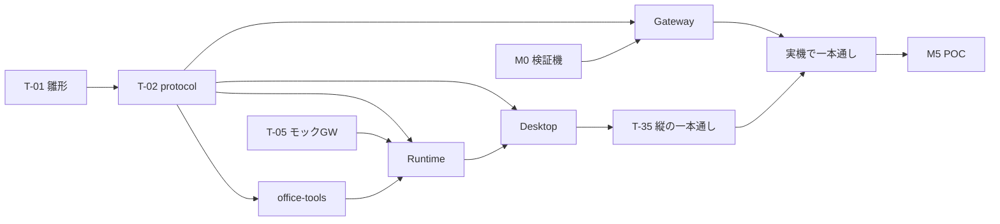

# ローカルLLMデスクトップエージェント 実装計画

2026年10月11日 · v1.0（基本設計書 §12 のタスク分解）

マイルストーン M0〜M6 を、実装できる単位（タスク）に分ける。各タスクには前提・成果物・完了条件・関連要件を付ける。状態は `local_llm_traceability.md` と、本書の「状態」列で管理する。

**進め方の方針**
- 推論サーバーがなくても進められる部分（protocol、office-tools、Runtime、UI）は、**モック Gateway を使って先に作る**。要件書の日程（PHASE 1 が 2027年1〜2月）より前倒しで進め、POC（2027年3月）の時間を評価と学習に充てる。
- 依存関係の順に「縦に1本通す」ことを優先する。最初の目標は、モックを相手に「請求書3件 → Excel」が画面から最後まで通ること（T-35）。

---

## 依存関係

---

## M0: 検証機の基盤（2026年11〜12月。検証機が届き次第）

| ID | タスク | 成果物・完了条件 | 要件 | 担当 | 状態 |
| --- | --- | --- | --- | --- | --- |
| T-M0-1 | OS・ドライバ・CUDA・Docker の構築 | `local_llm_ops/server_setup.md` §1〜3 が完了。`nvidia-smi` が動く | OPS | llm-inference-engineer | 未着手 |
| T-M0-2 | vLLM で Gemma 4 12B（QAT int4）を動かす | OpenAI 互換 API で応答する。32K 文脈・FP8 KV で起動する | 7.1 | 同上 | 未着手 |
| T-M0-3 | 制約付き生成の確認 | Action の oneOf スキーマ（30ツール相当）で `guided_json` が効くこと、文法のコンパイル時間を測る | RUN-04 | 同上 | 未着手 |
| T-M0-4 | 同時5件・入力4Kの簡易性能測定 | 最初の文字までの時間とトークン/秒を記録する（PRF-01〜03 の初回値） | PRF | 同上＋resilience-qa | 未着手 |
| T-M0-5 | 26B A4B を llama.cpp で CPU 退避して動かす | 動作と速度の記録 | R5 | 同上 | 未着手 |
| T-M0-6 | `VERSIONS.md` の記録 | ドライバ・CUDA・vLLM・モデルの版とハッシュ | 11.1 | 同上 | 未着手 |
| T-M0-7 | チャットテンプレートの確認 | Gemma 4 で tool ロールを使えるか確認し、`local_llm_prompts.md` §1 を確定する | — | llm-agent-architect | 未着手 |

## M1: 雛形とプロトコル（今すぐ着手）

| ID | タスク | 成果物・完了条件 | 要件 | 担当 | 状態 |
| --- | --- | --- | --- | --- | --- |
| T-01 | モノレポの雛形 | pnpm workspace・uv workspace・ESLint/ruff・vitest/pytest・`.gitignore` の追記・`e2e.config.json`。`pnpm test` と `uv run pytest` が空の状態で通る | — | llm-agent-architect | **完了**（2026-10-11） |
| T-02 | `packages/protocol` | `local_llm_protocol.md` の全スキーマを JSON Schema 化し、TS と pydantic を生成する。スキーマのサンプルによる検証テスト | 5章・6章 | 同上 | **完了**（47ツール・155定義。TS 198件／Py 56件） |
| T-03 | Action の文法生成器 | 有効なツール集合から oneOf を作る関数とキャッシュ（protocol §1.3） | RUN-04 | agent-runtime-engineer | **完了（grammar.ts。有効ツールの const 変種の oneOf）** |
| T-05 | モック Gateway | `/v1/config`・`/v1/steps`（SSE 再開・冪等キー）・`/v1/auth/*` の最小実装と、シナリオ YAML による応答（`local_llm_test_spec.md`） | — | llm-inference-engineer | **完了**（障害注入9種・pytest 15件・E2E 3件） |

## M2: 文書ツール（office-tools）

| ID | タスク | 成果物・完了条件 | 要件 | 担当 | 状態 |
| --- | --- | --- | --- | --- | --- |
| T-10 | MCP サーバーの骨組み | ToolSpec の注釈（`x-agent-*`）・ToolResult の封筒・continuation・エラーの分類 | AGT-09 | office-doc-tools-engineer | **完了（MCP stdio、注釈は annotations）** |
| T-11 | xlsx 読み取り | `xlsx.info` / `read_range` / `find` | XLS-01 | 同上 | **完了** |
| T-12 | xlsx 書き込みと再計算 | `write_cells` / `write_table` / 行列操作 / `create` / `recalc`（LibreOffice）。書式が保たれる試験 | XLS-02〜04, 08 | 同上 | **完了（LibreOffice 未導入のため実機の再計算は未検証）** |
| T-13 | csv と data.transform | 文字コード判定、式の構文解析器、Decimal での計算 | XLS-05, 07 | 同上 | **完了（純 Python＋Decimal）** |
| T-14 | pdf 読み取り | `pdf.info` / `read_pages` / `extract_tables`（pypdfium2＋pdfplumber） | PDF-01, 02 | 同上 | **完了** |
| T-15 | docx 読み取り | `docx.read` / `outline`（ブロックID） | DOC-01 | 同上 | **完了** |
| T-16 | docx 編集・作成 | `docx.edit`（全 op）/ `create`（テンプレート）。書式が保たれる試験 | DOC-02, 03 | 同上 | **完了** |
| T-17 | invoice.extract（OCR なし版） | テキストPDFからの抽出（推論はモック）と検算 | PDF-04 | 同上 | **完了（sampling で推論を依頼）** |
| T-18 | convert と変更履歴 | LibreOffice での変換、`track_changes`、`docx.diff` | DOC-04, 05, 08, 09 | 同上 | **完了（LibreOffice 未導入のため実機の変換は未検証）** |
| T-19 | PyInstaller でのビルド | 1フォルダにまとめ、Electron から起動できること | — | 同上 | **完了（office-tools.exe 90MB。tools/office/packaging/build.py、exe で E2E 合格）** |

## M3: Runtime と継続実行

| ID | タスク | 成果物・完了条件 | 要件 | 担当 | 状態 |
| --- | --- | --- | --- | --- | --- |
| T-20 | Run Store | SQLCipher・マイグレーション・`local_llm_data_model.md` §2 の全テーブル | RUN-01, APP-06 | agent-runtime-engineer | **完了（SQLCipher、12.9.0）** |
| T-21 | エージェントのループ（状態機械） | 設計書 §5.1 の遷移。遷移ごとの確定。kill して再開する試験 | AGT-01, RUN-02 | 同上 | **完了** |
| T-22 | Gateway クライアント | 冪等キー・SSE の再開・無制限のバックオフ・401 での refresh | RUN-03 | 同上 | **完了** |
| T-23 | ポリシーエンジン | 実体パスの解決・禁止領域・承認の判定・汚染フラグ。パスのすり抜け試験 | AGT-02, SEC-03, 04, NET-10 | 同上＋web-relay-security（レビュー） | **完了** |
| T-24 | 意図記録とバックアップ・元に戻す | intents・ReplaceFile・3通りの場合分け・ロック時の別名保存 | AGT-03, RUN-02, R11, R12 | 同上 | **完了（staging 方式）** |
| T-25 | fs-tools | protocol §3.1 の全ツール | — | 同上 | **完了** |
| T-26 | MCP クライアント | office-tools とプラグインの起動・再起動・注釈の解釈 | AGT-09 | 同上 | **完了** |
| T-27 | プロンプトの組み立てと文脈の圧縮 | `local_llm_prompts.md` の全雛形。75% での圧縮、固定メモリ | AGT-06 | 同上 | **完了（段階的な圧縮）** |
| T-28 | 停滞監視 | 3つの信号と段階的な対処（昇格先がない場合を含む） | AGT-04, RUN-05 | 同上 | **完了** |
| T-29 | batch.run | 件ごとの完了記録・再開・出力をまとめて書く・失敗一覧 | RUN-06 | 同上 | **完了** |
| T-29b | 承認待ち・質問の保留と継続 | deferred・ask_user・承認後の実行と差し込み | RUN-08 | 同上 | **完了** |

## M4: デスクトップアプリ・Gateway・縦の一本通し

| ID | タスク | 成果物・完了条件 | 要件 | 担当 | 状態 |
| --- | --- | --- | --- | --- | --- |
| T-30 | Electron の骨組み | main / preload / renderer、Runtime ホスト（Node の子プロセス）の起動、トレイ・通知・スリープ抑止 | RUN-07 | desktop-app-engineer | **完了（Runtime は Node の子プロセス。ADR-001 改訂）** |
| T-31 | ログインと設定 | `main:auth.*`、トークンの safeStorage への保存、ネット設定 | ADM-01, NET-01 | 同上 | **完了（独自アカウント、safeStorage）** |
| T-32 | 会話画面 | 逐次表示・手順カード・タスク一覧・添付・定型作業 | APP-01〜05, 09 | 同上 | **完了（添付は📎とドラッグ＆ドロップ、定型作業は / で候補）** |
| T-33 | 承認・質問・差分・元に戻す | 承認ダイアログと承認一覧、差分プレビュー | AGT-02, 03, APP-07 | 同上 | **完了（差分は Word=段落・Excel=セル・テキスト=行）** |
| T-34 | 状態の表示 | run.state の全値、待ち順、再接続、サーバー停止 | APP-10, OPS-02 | 同上 | **完了** |
| **T-35** | **縦の一本通し（モック）** | モック Gateway を相手に「請求書3件 → Excel」が画面から完了まで通る。途中で Runtime を kill しても再開できる。E2E を自動化する | 9.2-1 | desktop＋runtime＋qa | **完了（E2E 自動化済み）** |
| T-40 | Gateway 本体 | 認証（ADR-008）・永続キュー・公平スケジューリング・暗号化ペイロード・SSE・`/v1/config` | RUN-09, 10, SEC-02, 06 | llm-inference-engineer | **完了（server/gateway。SQLite で試験 50件、PostgreSQL 版は Docker 起動後に要実行。管理 API・管理画面の配信・上流への内部トークンを統合時に追加）** |
| T-41 | OCR サービス | `/v1/vision/ocr`。エンジンの比較を準備する | PDF-03 | 同上 | **完了（server/ocr。エンジンは PaddleOCR / VLM / 試験用を差し替え可。実エンジンの比較は M0〜M5）** |
| T-45 | 実機での一本通し | 検証機の vLLM＋Gateway で T-35 のシナリオが通る | 9.2-1 | 全員 | 未着手 |
| T-46 | インストーラと自動更新 | electron-builder（NSIS）・社内配布・自動更新 | ADM-05 | desktop-app-engineer | **完了（Node 22.23.3 と office-tools を同梱した NSIS インストーラ 183MB。自動更新は Gateway からの配布で実装（ADM-05）。署名は未）** |

## M5: POC（2027年3月）

| ID | タスク | 成果物・完了条件 | 要件 | 担当 | 状態 |
| --- | --- | --- | --- | --- | --- |
| T-50 | 評価ハーネス | `eval/harness` と評価セットの manifest（PHASE 0 の正解データを使う） | 9.1 | resilience-qa-engineer | **一部完了（eval/harness: manifest 検証・data_hash・学習データとの重複照合・合成データ・採点（帳票抽出・ツール操作・文書品質）・合否表・台帳向け出力。サンプル3セットがモックで通る。実データの評価セットは PHASE 0 の正解データ待ち）** |
| T-51 | 障害注入試験 FI-01〜20 | 完了100%・重複0件 | 9.1 継続実行 | 同上 | **完了（eval/fault-injection。18件を自動化: FI-01〜09・11〜13・15〜20。FI-08・09 は CI ではモックの停止で代替。試験中に Runtime の不具合2件を発見・修正（再開時の二重書き込み、承認済み操作の取りこぼし）。FI-10 はデスクトップ E2E、FI-14 は試験機で手動）** |
| T-52 | 手順例の合成とツール呼び出し学習 | `ml/datagen` で数千件を合成して検証 → 12B の QLoRA → ベースモデルとの比較 | 7.2-2, 9.2-2 | ml-finetuning-engineer | 一部完了（合成と検証は済み〈`ml/datagen`、雛形11種〈プロンプトインジェクションへの対応を含む〉・統合試験・評価セットとの重複照合・パスの匿名化〉。学習の準備は済み〈`ml/training`: 学習用の形式への変換・検証用の分割・設定の検証・QLoRA スクリプト・dry-run〉。数千件の生成・12B の QLoRA の実行・比較は検証機で） |
| T-53 | 量子化の比較 | QAT int4 / AWQ / FP8 の精度と速度 | 7.2-1 | 同上 | 未着手 |
| T-54 | 代表シナリオ3本と性能の実測 | 9.2 の条件1・3 を判定する材料 | 9.2 | qa＋inference | 未着手 |
| T-55 | 部門代表の試用 | 試用の手順書とアンケート | 9.2-4 | desktop（手順書） | **手順書とアンケートを作成（`local_llm_ops/trial_guide.md`）。試用の実施は PHASE 2** |

## M6: 本開発（2027年4〜6月）

| ID | タスク | 要件 | 担当 | 状態 |
| --- | --- | --- | --- | --- |
| T-60 | RAG（取り込み・検索・ACL・評価） | AGT-07, SEC-07, ADM-02 | rag-search-engineer | **完了（server/rag。ハイブリッド検索・ACL を検索条件に・差分取り込み。試験 53件。実モデル・実データでの評価は未）** |
| T-61 | Web Relay（検索・取得・DLP・SSRF・利用回数） | NET-01〜13 | web-relay-security-engineer | **完了（server/web-relay。試験181件。DLP・SSRF・読み取り専用・本文抽出・回数・監査。機密語・サイトは Gateway の DB から定期取り込み（取り込めるまで断る））** |
| T-62 | 管理画面 | ADM-02〜04, NET-02, 08 | desktop-app-engineer | **完了（apps/admin-web。利用者・ネット・機密語・共通指示・監査・ダッシュボード・モデル台帳（評価の条件・本番化・切り戻し）。機密語の読みも登録可）** |
| T-63 | 業務 LoRA | 7.2-3 | ml-finetuning-engineer | 未着手 |
| T-64 | 本番機での 26B の評価と既定モデルの決定 | 7.1 | inference＋ml | 未着手 |
| T-65 | 監視・バックアップ・予備機への切替 | OPS-03〜06 | llm-inference-engineer | **一部完了（アラートのルール・Alertmanager・node-exporter、毎晩のバックアップと復元のスクリプト＋systemd timer＋試験5件。compose に rag を追加し、Gateway の上流ポートの食い違いを修正。予備機への自動切替（クライアント・設定画面・FI の OPS-03）。実機での復元訓練は未）** |
| T-66 | Should / Could の残り（グラフ・コメント・画像説明・自動振り分けなど） | 各要件 | 各担当 | 未着手 |
| T-67 | 安全性・ネットの評価セット | 9.1 | web-relay-security＋qa | **一部完了（プロンプトインジェクション SX-01〜07 を自動化し、評価セット security で集計。DX・RX は Web Relay の試験。実モデルでの評価は検証機で）** |

---

## 直近の着手順

1. **T-01 → T-02 → T-05**（雛形・プロトコル・モック Gateway）
2. **T-10 → T-11 → T-12**（Excel から。代表シナリオ「請求書 → Excel」に必要な順）
3. **T-20 → T-21 → T-22 → T-23 → T-24 → T-25 → T-27**（Runtime の中核）
4. **T-14 → T-17 → T-29**（PDF と一括処理）
5. **T-30 → T-32 → T-33 → T-35**（画面と縦の一本通し）
6. 検証機が使えるようになったら、M0 を並行して進める
