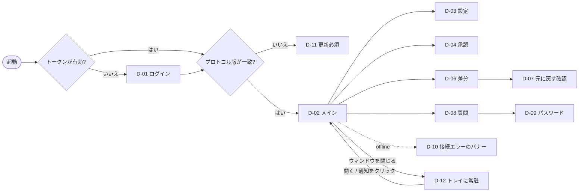

# ローカルLLMデスクトップエージェント 画面仕様書

2026年10月11日 · v1.0-draft（要件書 5.1・5.3〜5.5、基本設計書 §4、プロトコル仕様 §4・§5 の詳細化）

デスクトップアプリ（`apps/desktop`、Electron＋React）と管理画面（`apps/admin-web`）の画面・状態表示・操作・文言を定める。画面からの操作は**プロトコル仕様 §5 の RuntimeCommand だけ**で Runtime に伝え、表示は RuntimeEvent だけから作る（Renderer は状態を持たない。設計書 §4.2）。

- 前提: 認証は独自アカウントで行う（将来 Entra ID を追加できる）。設計書 §1 の R3・R4・R8・R10・R12 はすべて採用済み。
- 表記: `cmd:xxx` は RuntimeCommand、`evt:xxx` は RuntimeEvent、`main:xxx` は Main プロセスが preload で公開する API（プロトコル外。認証・ウィンドウ操作など）、`GW:` は Gateway の API。

---

## 1. 画面一覧と遷移

### 1.1 デスクトップアプリ

| ID | 画面 | 種別 | 開き方 | 主な要件 |
| --- | --- | --- | --- | --- |
| D-01 | ログイン | 全画面 | 起動時にトークンがないか、リフレッシュに失敗した | ADM-01 |
| D-02 | メイン（3ペイン） | 全画面 | ログイン後 | APP-01〜11 |
| D-03 | 設定 | モーダル（タブ付き） | ヘッダーの ⚙ / トレイ | NET-01, APP-08 |
| D-04 | 承認ダイアログ（1件） | モーダル | `evt:approval.request` を受けたとき（ウィンドウが前面にある場合）／右ペインの承認一覧で項目をクリック | AGT-02, RUN-08 |
| D-05 | 承認一覧（まとめて承認） | 右ペインのタブ | 常に表示 | RUN-08, NET-10 |
| D-06 | 差分プレビュー | 中央を置き換えるビュー（戻るで会話へ） | `evt:artifact` のカード／変更ファイル一覧 | AGT-03 |
| D-07 | 元に戻す確認 | モーダル | 変更ファイル一覧の［元に戻す］ | AGT-03 |
| D-08 | 質問（ask_user） | 会話内のインラインカード＋通知 | `evt:question` | — |
| D-09 | パスワード入力 | モーダル | `evt:question` で `secret_hint: true` | PDF-06 |
| D-10 | サーバー接続エラー | 全体バナー（画面はそのまま操作できる） | `evt:server.status` が offline | OPS-02 |
| D-11 | アプリ更新必須 | 全画面（会話の閲覧だけ可能） | プロトコルのメジャー版の不一致（プロトコル §6） | ADM-05 |
| D-12 | トレイメニュー | OS のメニュー | トレイアイコンを右クリック | RUN-07 |
| D-13 | Windows 通知 | OS の通知 | `evt:notify` | RUN-08 |



- ウィンドウを閉じても終了しない（トレイに残る。RUN-07）。終了はトレイの［終了］だけで行い、実行中の作業があれば確認ダイアログを出す（§2.12）。
- 通知（D-13）をクリックすると、該当する会話を開いて D-02 を前面に出す。承認の通知なら D-04 を開く。

### 1.2 管理画面（admin-web、ブラウザで Gateway の `/admin` を開く）

| ID | 画面 | 主な要件 |
| --- | --- | --- |
| A-01 | ダッシュボード（件数・応答時間・GPU・待ち件数・エラー） | ADM-03, OPS-05 |
| A-02 | 利用者・部門（登録、パスワード再発行、部門、役職、同時実行数の上限、RAG の閲覧グループ） | ADM-01, ADM-02, ADM-04 |
| A-03 | ネットアクセスの上限（全社停止、部門・利用者ごとの上限、月の検索上限） | NET-02, NET-13 |
| A-04 | 禁止サイト・信頼サイト | NET-08 |
| A-05 | 機密語辞書 | NET-07 |
| A-06 | 監査ログ（ファイル操作・AI利用・Web） | SEC-05, NET-11 |
| A-07 | モデル（台帳の一覧、本番版の切替、切り戻し、既定モデル） | ADM-05, 7.4 |
| A-08 | 共通指示・定型作業の配信 | AGT-10, APP-09 |
| A-09 | 評価データ候補（同意済みの評価付きやり取りの確認） | ADM-06 |

管理画面は管理者ロールだけが開ける。ログインはデスクトップアプリと同じ独自アカウントで行う。

---

## 2. ワイヤーフレーム

### 2.1 D-01 ログイン

```
┌──────────────────────────────────────────────┐
│                                              │
│          ローカルAIアシスタント                │
│                                              │
│   ユーザーID  [________________________]      │
│   パスワード  [________________________] 👁   │
│   □ このPCでログイン状態を保つ（30日）         │
│                                              │
│              [   ログイン   ]                 │
│                                              │
│   接続先: ai-server.local  （変更）            │
│   ⚠ ユーザーIDまたはパスワードが違います        │  ← エラー時だけ表示
│   ── 将来: [Microsoft アカウントでログイン] ── │  ← Entra ID 導入後に表示（今は非表示）
└──────────────────────────────────────────────┘
```

- ［ログイン］→ `main:auth.login({user, password, remember})` → Main が `GW: POST /v1/auth/login` を呼ぶ。成功したらトークンを `safeStorage` に保存する。
- 「接続先（変更）」は管理者向けで、本番機と予備機の URL を編集できる（OPS-03）。
- 5回失敗したらサーバー側でロックされる（エラー文言 `auth.locked`）。

### 2.2 D-02 メイン（3ペイン）

> **2026-10-15 改訂（会話中心の2ペイン）**: 実モデルで試すと、1回の依頼で手順のカードが数十枚並び、答えが埋もれた。そこで次のように改めた（詳細とトークンは `apps/desktop/DESIGN.md`）。下のワイヤーフレームは改訂前のもの。
> - 左のサイドバー（新しい会話・検索・最近の会話・ファイル・利用者と設定）と、中央の会話の列（最大幅 760px）の2ペインにする。計画と承認の右ペインは無くした。
> - 1回の依頼の手順は、依頼の下の1行にまとめる。実行中は「Excel を書き換えています…・N件の手順・計画 2/3」、終わると「N件の手順を実行しました・失敗 M 件」。開くと、計画と1手1行の一覧が出る。
> - 答え（完了報告の summary）は、枠のない本文として Markdown（段落・箇条書き・表・太字など）で表示する。
> - 承認・質問・変更したファイル（開く・差分・元に戻す）・出典・できなかったこと（failures）・確認してください（needs_review）・失敗したままの操作（Runtime の unresolved）は、折りたたまずに答えの下に出す。
> - 入力欄は列の下端の角丸カード。添付・作業フォルダ・モデル・ネットの操作をカードの中に置く。空の会話では例の依頼を4つ示す。

```
┌────────────────────────────────────────────────────────────────────────────────────┐
│ ローカルAI │ モデル:[自動 ▾] │ 🌐 ネット: オフ │ ● サーバー接続中 │ 待ち: 2番目(約40秒) │ ⚙ 👤 │ ← ヘッダー
├──────────────┬───────────────────────────────────────────┬─────────────────────────┤
│ [会話][ファイル]│ 会話: 9月分 請求書の取込   📁 \\nas\経理\9月  │ [タスク][承認 2][変更 5]  │
│ 🔍 [検索____] │──────────────────────────────────────────── │ ─ タスク ─               │
│ + 新しい会話  │ 👤 請求書フォルダを読んで送金明細をExcelに…   │ ✔ 請求書の抽出           │
│ ▸ 9月分請求書 │                                            │ ▶ Excel に集計           │
│   実行中 ●    │ 🤖 計画: 抽出 → 集計 → Excel作成            │ ○ 完了報告               │
│ ▸ 契約書比較  │ ┌ ▾ 一括処理 invoice.extract  8/10  ⟳ ┐    │                         │
│   承認待ち ⚠  │ │  失敗 1件: 請求書_07.pdf（壊れたファイル）│ │ ─ 状態 ─                 │
│ ▸ 先週の議事録│ └──────────────────────────────┘    │ 実行中 12分 ・ 手順 14   │
│   完了 ✓      │ ┌ ▸ xlsx.create 送金明細.xlsx  ✓ 差分 ┐    │                         │
│               │ └──────────────────────────────┘    │                         │
│ ─ ファイル ─  │ ┌ ? 質問: 通貨がUSDの請求書は円換算… ┐    │                         │
│ 📁 9月        │ │ (●)換算しない ( )当日レートで換算     │    │                         │
│  📄 請求書_01 │ │                     [回答する]       │    │                         │
│  📄 …         │ └──────────────────────────────┘    │                         │
│               │────────────────────────────────────────── │                         │
│               │ 📎 [ここに依頼を入力… /で定型作業 ]  [送信]   │                         │
│               │ [⏸ 一時停止] [■ 停止]                       │                         │
└──────────────┴───────────────────────────────────────────┴─────────────────────────┘
```

**左ペイン**
- ［会話］タブ: 会話一覧（新しい順）。各項目に状態バッジを付ける（実行中●／承認待ち⚠／停滞⏳／一時停止⏸／完了✓／停止■）。検索は `cmd:conversation.search`（APP-06）。
- ［ファイル］タブ: 会話に紐づいた作業フォルダのツリー（APP-03）。ファイルをダブルクリックすると OS の既定アプリで開く（`main:shell.openPath`）。ファイルを入力欄にドラッグすると添付になる。

**中央**
- 会話のメッセージと手順カード（§3.2）。最終回答は `evt:token` で逐次表示する（APP-01）。
- 会話の見出し行で作業フォルダを表示する。変更できるのは、その会話の実行が始まる前だけ（`main:dialog.pickFolder`）。
- 入力欄: ファイルのドラッグ＆ドロップ（APP-02）、`/` で定型作業の候補を出す（APP-09）。送信は Ctrl+Enter（Enter は改行）。

**右ペイン**
- ［タスク］: `evt:plan` の計画と進捗（APP-05）、経過時間、手順数、昇格中かどうか。
- ［承認 n］: D-05。
- ［変更 n］: その会話で変更したファイルの一覧（`evt:artifact`）。各行に［差分］［元に戻す］を置く（§2.6, §2.7）。

### 2.3 D-03 設定

```
┌ 設定 ──────────────────────────────────────── ✕ ┐
│ [全般] [ネット] [通知] [アカウント] [このアプリについて] │
│ ── ネット ──                                    │
│ ネットアクセス                                   │
│  (●) オフ（既定）        ネットに一切接続しません    │
│  ( ) 検索のみ            検索結果の見出しと要約だけ  │
│  ( ) 検索＋ページ閲覧    ページ本文・公開PDFも読む   │  ← 管理者の上限を超える選択肢は灰色＋「管理者により制限」
│  管理者の上限: 検索のみ（経理部）                   │
│  今月の検索回数: 23 / 200                          │
│ ── 全般 ──                                       │
│  既定のモデル  [自動 ▾]  自動／高速(12B)／高精度(26B) │
│  ログオン時に自動起動  [✓]                        │
│ ── 通知 ──                                       │
│  長時間の作業の通知 [120] 分（既定2時間）            │
│  完了 [✓] 承認待ち [✓] 停滞 [✓]                   │
│                                   [キャンセル][保存]│
└─────────────────────────────────────────────────┘
```

- ［保存］→ `cmd:settings.update({ net_level, model_default, notify_long_run_minutes })`。
- ネットの上限と月の検索回数は `GW:/v1/config` から取得する。上限を超える選択肢は無効化して理由を表示する（NET-02）。
- 承認待ちと停滞の通知はオフにできない（チェックボックスを無効化）。完了の通知だけオフにできる。
- ［アカウント］: パスワードの変更、ログアウト（`main:auth.logout`。実行中の作業がある場合は確認を出す）。

### 2.4 D-04 承認ダイアログ（1件）

```
┌ 承認が必要です ───────────────────────────────── ✕ ┐
│ ⚠ 作業フォルダの外のファイルを変更しようとしています    │  ← reason ごとの見出し（§5）
│                                                  │
│ 操作      : ファイルの上書き（xlsx.write_cells）      │
│ 対象      : C:\Users\yamada\Documents\予算.xlsx      │
│ 実体パス  : C:\Users\yamada\Documents\予算.xlsx      │  ← real_path が path と違うときは赤字で強調
│ 作業フォルダ: \\nas\経理\9月                          │
│ AIの説明  : 「予算シートに9月の実績を転記します」      │  ← 直前の thought（参考情報）
│ ┌ 🌐 この会話はネットの情報を読んでいます ─────────┐ │  ← tainted=true のときだけ表示
│ │ ネット上の文章に紛れた指示で操作している可能性が   │ │
│ │ あります。内容をよく確認してください。            │ │
│ └──────────────────────────────────────┘ │
│ □ この会話では同じフォルダへの同じ操作を自動で承認する  │  ← 削除・汚染中は非表示
│                                                  │
│          [却下する]                [承認する]        │  ← 既定のフォーカスは［却下する］
└──────────────────────────────────────────────────┘
```

- ［承認する］→ `cmd:approval.decide({ approval_id, decision: "approve", remember? })`。［却下する］→ `decision: "reject"`。
- ✕ や Esc で閉じても判断したことにはならない（承認待ちのまま一覧に残る）。
- 引数の詳細（args の JSON）は「詳細を表示」で展開する。

### 2.5 D-05 承認一覧（右ペイン［承認］タブ）

```
─ 承認待ち 3件 ─────────────────────
[□ すべて選択]          [選択を承認][選択を却下]
□ 上書き  C:\…\予算.xlsx           [確認]
□ 削除    請求書_old.pdf  🗑         [確認]   ← 削除はチェックボックスなし（1件ずつ）
  上書き  D:\共有\報告.docx  🌐      [確認]   ← 汚染中はチェックボックスなし（1件ずつ）
```

- まとめて承認できるのは「`tainted=false` かつ削除以外」の項目だけ（NET-10、設計書 §5.3）。それ以外の項目にはチェックボックスを出さず、［確認］で D-04 を開いて1件ずつ判断させる。
- ［選択を承認］は選んだ件数分の `cmd:approval.decide` を送る。送る前に「n件を承認します」という確認を1回だけ出す。
- 承認待ちがあっても、ほかの手順は進んでいることを一覧の上部に表示する（`ui.approval.continuing`）。

### 2.6 D-06 差分プレビュー

```
┌ ← 会話に戻る   送金明細.xlsx（上書き・手順 14）      [ファイルを開く][元に戻す] ┐
│ [Word: 段落の比較] / [Excel: セルの変更一覧] / [新規: 内容のプレビュー]           │
│ Excel の例:                                                               │
│ シート  番地  変更前          → 変更後                                       │
│ 明細    B12   (空)           → 2026-09-15                                   │
│ 明細    F12   (空)           → =SUM(F2:F11)   ⚠ 再計算エラー #REF!             │
│ Word の例:  － 支払期日は請求日から30日とする。                                │
│            ＋ 支払期日は請求日から45日とする。  （変更履歴として出力 ✓）          │
└──────────────────────────────────────────────────────────────────────┘
```

- 差分の取得は `main:diff.get(diff_ref)`（Runtime が `evt:artifact` の `diff_ref` で示したものを読む）。
- `renamed_from` がある成果物には「元のファイルが開かれていたため別名で保存しました」という帯を表示する（R12、§5 `ui.artifact.renamed`）。

### 2.7 D-07 元に戻す確認

```
┌ 元に戻す ───────────────────────────────────── ✕ ┐
│ 次のファイルを、この会話で変更する前の状態に戻します。  │
│ ☑ 送金明細.xlsx（新規作成 → 削除されます）           │
│ ☑ 請求書一覧.docx（上書き → 変更前に戻ります）        │
│ ⚠ 予算.xlsx は AI の変更の後に手で編集されています。   │  ← 現在のハッシュが post_hash と違う場合
│   戻すと、その編集も失われます。                       │
│                       [キャンセル]  [元に戻す]          │
└────────────────────────────────────────────────┘
```

- ［元に戻す］→ `cmd:undo.run({ run_id, paths })`（チェックを入れたものだけ）。
- 実行中の会話では［元に戻す］を無効化する（先に一時停止か停止をさせる）。

### 2.8 D-08 質問（ask_user）と D-09 パスワード

```
┌ ? AIからの質問 ──────────────────────────────┐
│ 通貨がUSDの請求書が2件あります。円に換算しますか？ │
│ (●) 換算しない  ( ) 当日のレートで換算  ( ) その他 [____] │
│                                      [回答する]  │
└──────────────────────────────────────────────┘
┌ パスワードの入力 ──────────────────────── ✕ ┐
│ 「契約書_A社.pdf」はパスワードで保護されています。 │
│ パスワード [______________] 👁                 │
│ ※ AIには伝わらず、保存もされません               │
│               [スキップ]   [開く]              │
└────────────────────────────────────────────┘
```

- ［回答する］→ `cmd:question.answer({ question_id, answer })`。パスワードの［開く］→ `secret: true` を付けて送る。［スキップ］→ `answer: ""`, `secret: true`（Runtime はその件を失敗として記録する）。
- 質問への回答待ちの間も、ほかの手順は進む。会話一覧のバッジは「質問あり ?」にする。

### 2.9 D-10 サーバー接続エラー（バナー）

```
┌──────────────────────────────────────────────────────────────┐
│ ⚠ サーバーに接続できません。再接続しています（5回目・次は30秒後）  │
│   AIを使わない作業は続けています。ファイルは壊れません。  [詳細]    │
└──────────────────────────────────────────────────────────────┘
```

- `evt:server.status` が `offline` の間、ヘッダーの直下に出す。`evt:retry` の `attempt` と `next_in_ms` で文言を更新する。`degraded` は黄色で「サーバーが混雑しています」と表示する。
- 予備機に切り替わったら、情報トースト「予備サーバーに接続しました」を出す（`endpoint` の変化で判定）。

### 2.10 D-11 アプリ更新必須

```
┌──────────────────────────────────────────────┐
│  アプリの更新が必要です                         │
│  サーバーが新しい版に更新されました。             │
│  このままでは AI を使えません。                  │
│  [今すぐ更新して再起動]                          │
│  （過去の会話は閲覧できます）  [会話を見る]        │
└──────────────────────────────────────────────┘
```

### 2.11 D-12 トレイメニュー

```
ローカルAI
 ├ 開く
 ├ 実行中の作業: 2件
 │   ├ 9月分請求書の取込（実行中 12分）  ▸ 開く / 一時停止
 │   └ 契約書比較（承認待ち 1件）        ▸ 開く
 ├ すべて一時停止
 ├ 設定…
 └ 終了
```

- トレイアイコンは状態で変える: 通常／実行中（動きのあるアイコン）／要対応（承認・質問・停滞がある）／オフライン。
- ［終了］のとき実行中の作業があれば「実行中の作業はいったん止まり、次回起動時に自動で再開します。終了しますか？」と確認する。終了は Runtime の確定済み状態をそのまま残す（停止の扱いにはしない）。

### 2.12 D-13 Windows 通知

| `evt:notify` の kind | タイトル | 本文の例 | クリックしたとき |
| --- | --- | --- | --- |
| `done` | 作業が完了しました | 「9月分請求書の取込」— 出力 1件・失敗 1件 | 会話を開く |
| `approval` | 承認が必要です | 「予算.xlsx の上書き」ほか 2件 | D-04 を開く |
| `stalled` | 作業が進んでいません | 「契約書比較」— 方針を変えても進展がありません。確認してください | 会話を開く |
| `long_run` | 作業が長時間続いています | 「9月分請求書の取込」— 2時間経過（作業は続けています） | 会話を開く |

---

## 3. 状態ごとの表示

### 3.1 `evt:run.state` とヘッダー・会話一覧・入力欄

| state | ヘッダー／会話見出しの表示 | 会話一覧のバッジ | 一時停止 | 停止 | 送信欄 |
| --- | --- | --- | --- | --- | --- |
| `planning` | 「計画を立てています…」スピナー | 実行中● | 可 | 可 | 追加の指示を送れる（次の推論の前に差し込む） |
| `inferring` | 「考えています…」スピナー、`evt:queue` があれば待ち順 | 実行中● | 可 | 可 | 同上 |
| `tool_running` | 「<ツール名の和名>を実行中…」 | 実行中● | 可 | 可 | 同上 |
| `waiting_approval` | 「承認待ちがあります（n件）」⚠ | 承認待ち⚠ | 可 | 可 | 同上 |
| `waiting_question` | 「質問への回答待ちです」⚠＋質問カードへのリンク | 質問あり⚠ | 可 | 可 | 同上 |
| `compacting` | 「これまでの経緯を整理しています…」 | 実行中● | 可 | 可 | 同上 |
| `replanning` | 「方針を立て直しています…」（detail に昇格先があれば「高精度モデルに切り替えました」） | 実行中● | 可 | 可 | 同上 |
| `stalled` | 「作業が進んでいません。低優先度で続けています」⏳＋［指示を追加］［停止］ | 停滞⏳ | 可 | 可 | 指示の追加を促す枠を強調表示 |
| `paused` | 「一時停止中」⏸＋［再開］ | 一時停止⏸ | — | 可 | 送信すると再開する |
| `reconnecting` | 「サーバーに再接続しています（n回目）」 | 実行中●（灰色） | 可 | 可 | 同上 |
| `done` | 「完了」✓（経過時間・手順数） | 完了✓ | — | — | 新しい依頼として送れる |
| `stopped` | 「停止しました」■（停止時点までの変更を右ペインに表示。APP-07） | 停止■ | — | — | 新しい依頼として送れる |

- 実行中の追加指示は `cmd:run.start`（同じ `conversation_id`）で送る。Runtime は実行中であれば新しい run を作らず、次の推論の前に差し込む。
- 停止は確認ダイアログを1回出す（「停止すると再開できません。ここまでの変更は残ります」）。一時停止は確認なしで実行する。

### 3.2 手順カード（`evt:step`）

```
┌ ▸ 📊 xlsx.write_cells  送金明細.xlsx  明細!B2:F11  ✓ 0.8秒  [差分] ┐  ← 折りたたみ（既定は閉じる。APP-04）
│  AIの説明: 抽出した10件を転記します                                │
│  引数: { … }（先頭300字）                                         │
│  結果: 50セルを書き込みました／再計算エラーなし                      │
└──────────────────────────────────────────────────────────┘
```

| status | アイコンと色 | 表示 |
| --- | --- | --- |
| `running` | ⟳ 青 | 経過秒を更新する |
| `ok` | ✓ 緑 | 所要時間。成果物があれば［差分］ |
| `error` | ✕ 赤 | エラーコードの和名＋message（例「ファイルが壊れています」）。AIが続けて対処するので、カードの帯は「AIが対処します」と表示する |
| `deferred` | ⏸ 橙 | 「承認待ち（ap-12）」＋［確認］ |

| kind | カードの見た目 |
| --- | --- |
| `tool` | 上記のとおり。web.* は 🌐 アイコンで、検索語と URL を省略せずに表示する（NET-04） |
| `plan` | 「計画を更新しました」1行（詳細は右ペインのタスク） |
| `ask` | D-08 のカード |
| `final` | 完了報告（Markdown）、出力ファイル（リンク）、失敗一覧、要確認の一覧、出典（ファイル・URL・社内文書）。NET-05, AGT-07 |
| `system` | 灰色の1行（例「これまでの経緯を整理しました」「高精度モデルに切り替えました」「元のファイルが開かれていたため別名で保存しました」） |

- 一括処理（`evt:batch_progress`）は1枚のカードにまとめ、進捗バー・完了件数・失敗件数を表示する。失敗件数をクリックすると、失敗一覧（ファイル名と理由）を展開する。

### 3.3 そのほかのイベントの表示

| イベント | 表示 |
| --- | --- |
| `evt:queue` | ヘッダーに「待ち: n番目（約m秒）」（APP-10）。`position` が0になったら消す |
| `evt:retry` | 該当する会話の見出しに「再試行中（n回目・次はm秒後）」。cause が `FILE_LOCKED` なら「ファイルが開かれています。閉じるのを待っています」 |
| `evt:net.activity` | 手順カード（🌐）に検索語・URL。`blocked` があれば橙の帯で理由（例 `DLP_BLOCKED` →「社外秘の語を含むため送信しませんでした」） |
| `evt:server.status` | ヘッダーの丸印（緑: online／黄: degraded／赤: offline）＋ D-10 |
| ネットのバッジ（ヘッダー） | 設定値を常に表示する: 「🌐 ネット: オフ」（灰）／「検索のみ」（青）／「検索＋閲覧」（青）。会話が汚染中なら「🌐 この会話はネットの情報を使用」（橙）を会話見出しに追加表示する（R10） |
| モデル | ヘッダーのモデル選択の隣に、実際に使っているモデル（例「12B」「26B（自動昇格中）」） |

---

## 4. 操作とコマンドの対応表

| 画面 | 操作 | 送るもの | 備考 |
| --- | --- | --- | --- |
| D-01 | ログイン | `main:auth.login` → `GW: POST /v1/auth/login` | プロトコル外 |
| D-02 | 送信 | `cmd:run.start({conversation_id, text, attachments, workspace, model})` | 新しい会話なら conversation_id は Main が採番する |
| D-02 | 一時停止／再開 | `cmd:run.pause` / `cmd:run.resume` | RUN-11 |
| D-02 | 停止 | `cmd:run.stop` | 確認あり |
| D-02 | 会話を開く・ウィンドウを開き直す | `cmd:conversation.get` → `cmd:events.since({conversation_id, seq})` | 最後に受け取った seq から取り直す（設計書 §4.2） |
| D-02 | 会話の検索 | `cmd:conversation.search` | APP-06 |
| D-02 | 会話の削除 | `cmd:conversation.delete` | 確認あり。バックアップも一緒に消える旨を表示する |
| D-02 | モデルの選択 | 次の `cmd:run.start` の `model` | 実行中の会話には反映しない |
| D-03 | 保存 | `cmd:settings.update` | |
| D-04 / D-05 | 承認・却下 | `cmd:approval.decide` | まとめて承認は件数分送る |
| D-07 | 元に戻す | `cmd:undo.run({run_id, paths})` | |
| D-08 / D-09 | 回答 | `cmd:question.answer` | |
| D-11 | 更新 | `main:update.install` | ADM-05 |
| D-12 | すべて一時停止 | 実行中の各 run に `cmd:run.pause` | |
| D-12 | 終了 | `main:app.quit` | 確認あり。run は停止しない |

---

## 5. 文言一覧（i18n キーと日本語）

キーは `apps/desktop/src/i18n/ja.json` に置く（APP-11。英語は将来 `en.json`）。

| キー | 文言 |
| --- | --- |
| `app.title` | ローカルAIアシスタント |
| `auth.user_id` | ユーザーID |
| `auth.password` | パスワード |
| `auth.remember` | このPCでログイン状態を保つ（30日） |
| `auth.login` | ログイン |
| `auth.error.invalid` | ユーザーIDまたはパスワードが違います |
| `auth.locked` | ログインに続けて失敗したため、一時的にロックされています。管理者に連絡してください |
| `auth.session_expired` | ログインの有効期限が切れました。もう一度ログインしてください（作業は続いています） |
| `conv.new` | 新しい会話 |
| `conv.search` | 会話を検索 |
| `input.placeholder` | 依頼を入力してください（/ で定型作業、ファイルはドラッグで添付） |
| `input.send` | 送信 |
| `run.pause` | 一時停止 |
| `run.resume` | 再開 |
| `run.stop` | 停止 |
| `run.stop.confirm` | 作業を停止します。停止すると再開できません。ここまでの変更は残り、元に戻すこともできます |
| `run.state.planning` | 計画を立てています… |
| `run.state.inferring` | 考えています… |
| `run.state.tool_running` | {tool}を実行中… |
| `run.state.waiting_approval` | 承認待ちがあります（{n}件） |
| `run.state.waiting_question` | 質問への回答待ちです |
| `run.state.compacting` | これまでの経緯を整理しています… |
| `run.state.replanning` | 方針を立て直しています… |
| `run.state.stalled` | 作業が進んでいません。低優先度で続けています。指示を追加するか停止してください |
| `run.state.paused` | 一時停止中 |
| `run.state.reconnecting` | サーバーに再接続しています（{n}回目） |
| `run.state.done` | 完了しました |
| `run.state.stopped` | 停止しました |
| `queue.position` | 待ち: {n}番目（約{s}秒） |
| `retry.file_locked` | 「{file}」が開かれています。閉じられるのを待っています |
| `server.offline` | サーバーに接続できません。再接続しています（{n}回目・次は{s}秒後）。AIを使わない作業は続けています。ファイルは壊れません |
| `server.degraded` | サーバーが混雑しています。応答に時間がかかることがあります |
| `server.failover` | 予備サーバーに接続しました |
| `approval.title` | 承認が必要です |
| `approval.reason.outside_workspace` | 作業フォルダの外のファイルを操作しようとしています |
| `approval.reason.delete` | ファイルを削除しようとしています（ごみ箱に移動します） |
| `approval.reason.move` | ファイルを移動しようとしています |
| `approval.reason.plugin_write` | 追加ツールがファイルを変更しようとしています |
| `approval.reason.tainted_outside` | ネットの情報を読んだ後に、作業フォルダの外を操作しようとしています |
| `approval.tainted_warning` | この会話はネットの情報を読んでいます。ネット上の文章に紛れた指示で操作している可能性があります。内容をよく確認してください |
| `approval.approve` | 承認する |
| `approval.reject` | 却下する |
| `approval.remember` | この会話では同じフォルダへの同じ操作を自動で承認する |
| `approval.bulk_confirm` | {n}件をまとめて承認します。よろしいですか？ |
| `approval.bulk_unavailable` | 削除と、ネットの情報を読んだ会話の操作は、1件ずつ確認してください |
| `approval.continuing` | 承認待ちの間も、承認の要らない作業は進めています |
| `artifact.renamed` | 元のファイルが開かれていたため、「{name}」という別名で保存しました |
| `undo.title` | 元に戻す |
| `undo.edited_after` | 「{file}」は AI の変更の後に手で編集されています。戻すと、その編集も失われます |
| `question.title` | AIからの質問 |
| `password.title` | パスワードの入力 |
| `password.note` | パスワードはAIには伝わらず、保存もされません |
| `net.badge.off` | ネット: オフ |
| `net.badge.search` | ネット: 検索のみ |
| `net.badge.browse` | ネット: 検索＋閲覧 |
| `net.tainted` | この会話はネットの情報を使用しています |
| `net.limited_by_admin` | 管理者により制限されています（上限: {level}） |
| `notify.done.title` | 作業が完了しました |
| `notify.approval.title` | 承認が必要です |
| `notify.stalled.title` | 作業が進んでいません |
| `notify.long_run.title` | 作業が長時間続いています |
| `update.required` | アプリの更新が必要です。このままでは AI を使えません |
| `quit.confirm` | 実行中の作業はいったん止まり、次回起動時に自動で再開します。終了しますか？ |

### 5.1 エラーコードの表示名（手順カード・net.activity）

| code | 表示 |
| --- | --- |
| `NOT_FOUND` | ファイルが見つかりません |
| `CORRUPT_FILE` | ファイルが壊れています（この件は飛ばしました） |
| `UNSUPPORTED_FORMAT` | この形式には対応していません |
| `STALE_DOCUMENT` / `BLOCK_NOT_FOUND` | ファイルが変わったため読み直します |
| `FORMULA_ERROR` | 数式にエラーがあります |
| `FORBIDDEN_PATH` | このフォルダは操作できません |
| `APPROVAL_REJECTED` | 却下されました |
| `NET_DISABLED` | ネットアクセスは許可されていません |
| `DLP_BLOCKED` | 社外秘の語を含むため送信しませんでした |
| `DOMAIN_BLOCKED` | このサイトは閲覧できません |
| `QUOTA_EXCEEDED` | 今月の検索上限に達しました（ネットなしで続けます） |
| `TOOL_FAILED` | 操作に失敗しました |
| （その他） | 予期しないエラーが発生しました（{code}） |

---

## 6. キーボード操作・アクセシビリティ・安全上の制約

### 6.1 キーボード操作

| キー | 動作 |
| --- | --- |
| Ctrl+Enter | 送信 |
| Ctrl+N | 新しい会話 |
| Ctrl+K | 会話の検索 |
| Ctrl+. | 一時停止／再開の切り替え |
| Ctrl+Shift+. | 停止（確認あり） |
| Ctrl+Shift+A | 承認一覧を開く（最初の承認待ちにフォーカス） |
| Ctrl+, | 設定 |
| Esc | モーダルを閉じる（承認は「判断なし」のまま残る） |
| Tab / Shift+Tab | すべての操作要素を巡回できる（巡回順は 左→中央→右） |

### 6.2 アクセシビリティ
- すべての操作がキーボードだけでできる。特に承認・却下・停止・一時停止（`desktop-app-engineer` の守ること 7）。
- 状態の変化（承認待ち・停滞・完了・オフライン）は `aria-live="polite"`、承認ダイアログの表示は `role="alertdialog"` で読み上げさせる。
- 色だけで状態を表さない（バッジにはアイコンと文字を併記する）。コントラスト比 4.5:1 以上。
- フォントサイズは設定で 90〜150% に変えられる。OS のハイコントラストモードに追従する。

### 6.3 安全上の UI 制約（必ず守る）
1. 承認ダイアログの既定フォーカスは［却下する］。Enter キーだけで承認されないようにする。
2. **汚染中（tainted=true）の承認と削除は、まとめて承認できない**。チェックボックスを出さず、「同じ操作を自動で承認」も表示しない（NET-10、設計書 §5.3）。
3. 承認ダイアログには、AIの説明（thought）より先に**実際の操作・対象パス・実体パス**を表示する。AIの説明は「参考情報」と明記する。
4. 実体パスがパスと異なる場合（リンク・ジャンクション経由）は赤字で強調する。
5. 文書・Webから取得したテキストを画面に出すときは、Markdown としてレンダリングせずプレーンテキストとして表示する（リンク・画像・HTML を実行しない）。最終回答（final.summary）は Markdown として表示するが、外部の画像は読み込まない。
6. パスワードは表示しない（👁 で一時表示だけできる）。ログと履歴には残さない。
7. ネットの状態バッジは非表示にできない（NET-04）。

---

## 7. 要件との対応

| 要件 | 対応する画面・仕様 |
| --- | --- |
| APP-01 | D-02 中央、`evt:token` |
| APP-02 | D-02 入力欄のドロップ |
| APP-03 | D-02 左［ファイル］、会話見出しの作業フォルダ |
| APP-04 | §3.2 手順カード |
| APP-05 | D-02 右［タスク］ |
| APP-06 | D-02 左［会話］、検索 |
| APP-07 | 停止と右［変更］ |
| APP-08 | ヘッダーのモデル選択、D-03 |
| APP-09 | 入力欄の `/`、A-08 |
| APP-10 | §3.3 `evt:queue` |
| APP-11 | §5 i18n |
| AGT-02 / AGT-03 | D-04, D-05, D-06, D-07 |
| RUN-07 | D-12 トレイ、ウィンドウを閉じても継続 |
| RUN-08 | D-05、D-13 の approval 通知、`approval.continuing` |
| RUN-11 | 一時停止・再開・停止 |
| RUN-05 | `stalled` / `replanning` の表示、D-13 stalled |
| NET-01 / NET-02 | D-03［ネット］、A-03 |
| NET-04 | ヘッダーのバッジ、🌐 手順カード |
| NET-05 / AGT-07 | final カードの出典 |
| NET-07 / NET-08 / NET-11 / NET-13 | A-05、A-04、A-06、A-03、§5.1 のエラー表示 |
| NET-10 | §6.3 の 2 |
| ADM-01〜06 | D-01、A-01〜A-09 |
| OPS-02 / OPS-03 | D-10 |
| PDF-06 | D-09 |
| R10 / R12 | 汚染バッジ（§3.3）、`artifact.renamed` |

## 8. 未決事項（プロトコル仕様への追加候補） — 解決済み

- `main:*`（preload API）の一覧はプロトコル仕様 §5.3 に追記した。
- 実行中の会話への `run.start` は「追加指示として差し込む」とプロトコル仕様 §5.1 に明記した。
- `run.state` に `waiting_question` を追加した（プロトコル仕様 §5.2）。表示は `waiting_approval` と同じ扱いにし、文言キーは `run.state.waiting_question`「質問への回答待ちです」とする。

## 追記（2026-10-12）: 生成中の表示と出典

- **生成中の表示（APP-01）**: 推論中は、モデルの出力（Action の JSON）から読める部分（summary / thought / question / note）だけを、点線の吹き出しで逐次表示する。JSON の記号は見せない。手順が確定したら消え、手順カードや完了報告に置き換わる。
- **出典（AGT-07, NET-05）**: 完了報告の下に「出典」を一覧表示する（種類: ファイル／社内文書／Web、参照先、該当箇所）。Runtime は、この会話で実際に読んだ記録（ツールの結果・利用者の発言）と照らし、照らせない出典に「確認できない出典」と表示する（作り話の出典を見分けるため。作業フォルダにあるファイルは確認できたものとする）。
- **予備機（OPS-03）**: 予備機に切り替わっている間、ヘッダーに「予備機で接続中」を表示する。
- **該当箇所を開く（PDF-07）**: 出典のうち、読んだ記録と照らせたファイルはクリックで既定のアプリで開く（PDF はページ番号を付けて開く。例 `p.12` → `#page=12`）。照らせない出典は開けない。
- **開かないファイル**: 実行ファイル・スクリプト・ショートカット・マクロ付きの Office 文書（.exe .bat .ps1 .lnk .xlsm など）は、ファイル一覧・成果物・出典のどこからも開かない（AI が書いたファイルを誤って実行しないため。`apps/desktop/src/shared/open-policy.ts`）。
